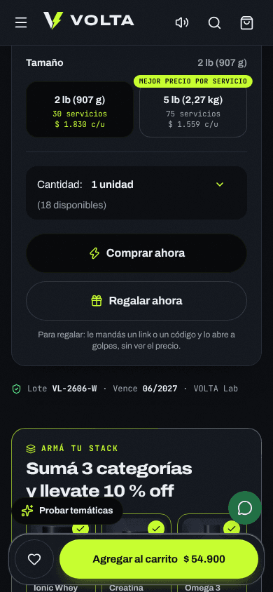
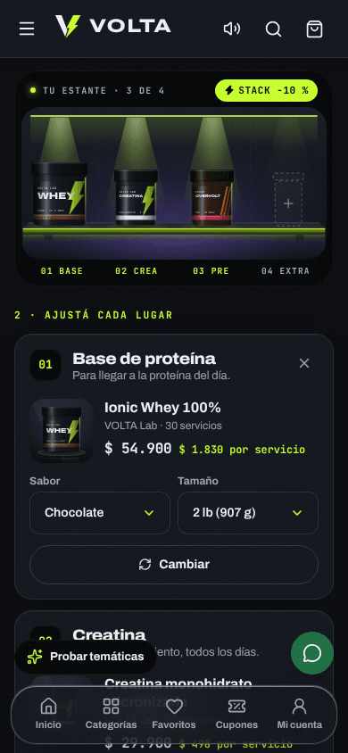
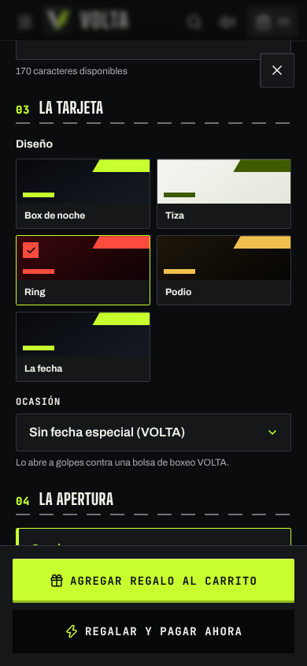
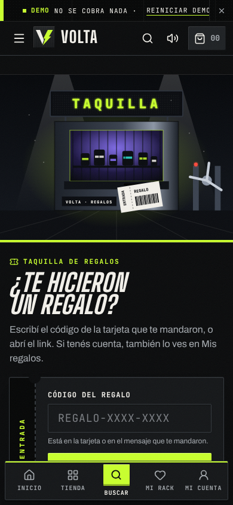

# Guion de demo · 10 minutos con el dueño de una tienda de suplementos

Para mostrarle VOLTA a un dueño de tienda de suplementos de Mar del Plata. El arco va **del dolor** (WhatsApp, Excel,
precios que cambian, vencimientos, clientes que no vuelven) **a lo que enamora** (la tienda en el celular) y **cierra
con el panel**, que es lo que le ahorra horas. Todos los botones, rutas, pedidos y clientes de este guion existen tal
cual en la demo.

- Demo publicada: `https://toti-gauna.github.io/supplements-ecommerce/` (o el link de la demo con la marca del
  prospecto, ver [marca-blanca.md](marca-blanca.md)). Las rutas de abajo se suman al final de esa dirección.
- VOLTA es una marca inventada. Si armaste la demo con la marca del prospecto, los nombres cambian pero los botones son
  los mismos.
- El panel trabaja con una fecha fija: **lunes 5 de octubre de 2026**. Por eso "a Juan se le termina la whey el
  jueves" siempre dice lo mismo, el día que sea.

## Resumen minuto a minuto

| Minuto | Momento | Dónde | Lo que tiene que quedar |
|---|---|---|---|
| 0:00 | El dolor | Charla, sin pantalla | Que el dueño cuente cómo trabaja hoy |
| 1:00 | La ficha que vende sola | Celular · `/p/ionic-whey/` | Precio por servicio, lote y vencimiento, cuánto le dura |
| 2:00 | Armá tu stack (y el quiz) | Celular · `/crear/` | Ticket más alto con el descuento stack |
| 3:00 | Ruleta y Shaker Rush | Celular · carrito y `/club/juego/` | Que juegue él: engancha y vuelve |
| 4:30 | Regalá energía y la taquilla | Celular · `/regalar/` y `/regalo/` | Que arme un regalo con la tarjeta en vivo y que golpee la bolsa |
| 5:15 | Temática del mes | Celular · "Probar temáticas" | La tienda cambia sola en cada fecha |
| 5:45 | Instagram desde el Estudio | Compu · `/admin-demo/estudio/` | Contenido listo sin diseñador |
| 6:30 | El panel: lo que le ahorra horas | Compu · `/admin-demo/` | Lista del proveedor, aumento, vencimientos, recompra, preparación, compras |
| 9:00 | Cierre comercial | Charla | Qué incluye, precio y próximo paso |

Si tenés **5 minutos**: dolor (30 s), ficha (1 min), juego (1 min), aumento de precios y vencimientos (1 min 30 s),
cierre (1 min). Si te pide **más**: quiz completo, compra de punta a punta con comprobante, emails y calendario.

---

## Antes de la reunión (preparación)

**El día anterior**
1. Abrí la demo en el celular que vas a usar y en la compu. Recorré el guion una vez entero.
2. Si vas con la marca del prospecto, revisá que el link sea el suyo y que el WhatsApp de la tienda sea un número de
   prueba (nunca el del cliente sin permiso).

**Diez minutos antes, en los dos equipos**
1. Tocá **Reiniciar demo** y aceptá el aviso. En la tienda está en la franja de arriba ("Demo de venta · Reiniciar
   demo"); en el panel, arriba a la derecha (en el celular es el ícono de la flecha circular). Vacía el carrito, la
   cuenta demo, la ruleta ya girada, el cupón del juego del día y lo que hayas probado en el panel.
2. **Temática**: la tienda pone sola la de la fecha (1 al 18 de octubre: Día de la Madre; 19 al 31: Halloween). Si
   querés mostrar otra, elegila **después** de reiniciar (reiniciar la saca): botón flotante **Probar temáticas** →
   por ejemplo **Probar Black Friday**. Para dejarla fija en todos los equipos: panel → **Campañas** → Modo
   **Siempre la que elija**.
3. **Modo**: oscuro es el de la marca y luce más. Si el local tiene mucha luz o el dueño ve poco, el botón sol/luna
   ("Activar modo claro") pone el claro "Tiza".
4. **Sonido**: el botón **Sonidos** de la tienda prendido y el volumen del celular a la mitad.
5. **Movimiento**: el celular **sin** "reducir movimiento" (si está activado, no aparece la pantalla de carga ni la
   tiza de la bolsa). Brillo alto, "no molestar" y cargador.
6. En la compu dejá abiertas cuatro pestañas: la tienda, `/admin-demo/`, `/admin-demo/importar/` y
   `/admin-demo/estudio/`.
7. Anotá a mano el código de regalo de la fecha: Día de la Madre `REGALO-MADR-E26B`, VOLTA `REGALO-VE1M-AR7X`; sabor
   abierto `REGALO-SAB0-R01D` y gift card `REGALO-GC0S-0F1D` (la cuenta demo tiene la gift card `GIFT-M4RC-0SAG` con $ 6.600)
   (el resto está en [estado.md](estado.md), Fase 5).

**Celular o compu**: la tienda siempre en el **celular** (es lo que ve su cliente; dáselo en la mano). El panel en la
**compu**, y al final mostrale que también anda en el celular.

---

## 0:00 · El dolor (1 minuto, sin pantalla)

No muestres nada todavía. Preguntá y escuchá; anotá dos o tres cosas para usarlas después.

- "¿Cuántos pedidos te entran por WhatsApp por día? ¿Quién los contesta?"
- "Cuando te llega la lista nueva del proveedor, ¿cuánto tardás en cambiar los precios?"
- "¿Cuántos potes se te vencieron este año en el estante?"
- "¿Sabés cuándo se le termina la whey a tu cliente? ¿Le escribís vos o te escribe la competencia?"
- "¿Y el Instagram? ¿Quién te hace las placas?"

Cerrá con: **"Bueno, te muestro cómo se ve todo eso resuelto. Primero lo que ve tu cliente, después lo que ves vos."**

## 1:00 · La ficha que vende sola (1 minuto, celular)

**Tocá**: inicio de la tienda (la pantalla de carga dura un segundo y sale en cada recarga) →
**¿Cuál es tu objetivo?** se ve al bajar → abrí **Ionic Whey 100%** (o directo `/p/ionic-whey/`).

**Mostrá y decí**:
- Precio grande ($ 54.900) y debajo **$ 1.830 por servicio**. "Tu cliente compara por scoop, no por pote."
- En **Tamaño**, el de 5 lb dice **Mejor precio por servicio** ($ 1.559 c/u). "Solito lo empuja al pote grande."
- **Lote VL-2606-W · Vence 06/2027** a la vista. "Originales, con lote. Eso da confianza."
- Bajá a **Información nutricional** (rótulo argentino, por porción y por 100 g) y a **¿Cuánto te dura?**: con su peso
  le dice cuántos días le dura el pote. Tocá **Avisame antes de que se termine**. "Y acá ya lo enganchaste para la
  próxima compra."

## 2:00 · Armá tu stack (1 minuto, celular)

**Tocá**: menú (☰) → **Armá tu stack** (`/crear/`) → objetivo **Fuerza**.

**Decí**:
- "Elige el objetivo y se le arma el estante: proteína, creatina y pre." Los potes caen y se prende el neón
  **Stack −10 %**.
- "Con tres categorías tiene 10 % de descuento: el ticket pasa de un pote a tres." Total **$ 109.530** y abajo el
  costo por día (**$ 3.202**).
- Tocá **Cambiar** en la creatina o el tamaño de la proteína: el precio se recalcula al toque.
- Cada pote tiene su tablero **te dura N días**. Tocá **Igualar duración**: ajusta tamaños y cantidades para que todo
  se termine más o menos junto. "Así no te pide la creatina sola a mitad de mes."
- Tocá **Agregar el stack al carrito** (en el celular está en la barra fija de abajo, con el total) y cerrá el carrito.

Si pregunta "¿y el que no sabe qué tomar?": **Hacé el quiz** (`/crear/quiz/`, "¿Qué necesitás?"): pantalla completa, una
pregunta por placa y avanza solo al elegir. Le arma el stack con el porqué de cada producto y **El protocolo del día**:
qué tomar a la mañana, antes y después de entrenar y a la noche. Si entrena **A la noche**, el pre sale sin cafeína. "Es lo que hoy le
explicás vos por WhatsApp, pero a las 11 de la noche."

## 3:00 · Ruleta y Shaker Rush (1 minuto 30, celular, en la mano del dueño)

**Tocá**: abrí el carrito (el "bolso"). Arriba de los productos está la placa **Tenés un giro del Disco olímpico** →
**Girar**. La ruleta ya no corta el pago: si no gira, va directo al checkout.

- Pasale el celular: **Cargá la barra** (mantener apretado y soltar; con el teclado, Espacio). Es un disco de pesas
  con luces. También está en el Club.
- Sale el premio (envío gratis, muestra, shaker, descuento): **Aplicar ahora**. "Todos ganan algo y el cupón es de un
  solo uso: no regalás plata, regalás ganas de volver."

**Después**: `/club/juego/` → **Jugar**. Que juegue 20 o 30 segundos: mueve el shaker con el dedo, atrapa scoops y
rayos, esquiva hamburguesas.
- "Con 300 puntos gana 5 %, con 800 un 10 %, con 1.500 envío gratis. Juega todas las veces que quiera, pero el cupón
  es uno por día." (Los premios los cambiás vos en el panel.)
- Si llegó a un premio: **Usar cupón ahora** (lo aplica y lo lleva al carrito). Si no: **Jugar de nuevo** o seguí.
- Mostrale el **ranking de la semana** y **Compartir puntaje**: arma una tarjeta 9:16 para historias.
- "¿Sabés cuánto tiempo se queda un pibe de 20 años jugando esto en tu tienda? Y cada vez que entra, ve tus ofertas."

## Si pide más · Club y Mi rack (1 minuto, celular)

- `/club/`: niveles con medallas, misiones de entrenamiento ("Entrená 3 veces esta semana") con **Reclamar premio**,
  que se cobra una sola vez. Al invitado lo invita a crear la cuenta demo, no le promete nada.
- Tocá el corazón en dos productos y abrí **Mi rack**: total, **Agregar todo al carrito**, **Armar stack con esto** y
  **Avisame si baja o si vuelve** (simulado: bajale el precio en el panel y el aviso salta).
- **Ayuda del box** (pie de página): preguntas por tema con buscador; "devolucion" sin tilde también encuentra.

## Si pide más · La compra de punta a punta (2 minutos, celular)

Con el stack en el carrito:

1. **El bolso**: un solo medidor de carga (envío gratis y descuento stack en la misma barra), **Te dura N días** en
   cada pote y, abajo, **"Cadete en Mar del Plata: llega mañana, mar 6 oct si confirmás en las próximas…"**. "La fecha
   sale de tu calendario de despachos y del cupo del cadete: si mañana ya no llega, el reloj lo avisa."
2. **Ir al checkout**: tres pasos (**Datos y entrega**, **Pago**, **Revisar**). Cada forma de entrega dice su fecha
   real ("Llega mañana, mar 6 oct", "Retiralo desde…", "Llega entre el vie 9 y el vie 16"). El ticket queda fijo al
   costado (en el celular, **Ver ticket**) y el cupón está una sola vez. Elegí **Transferencia bancaria**: el ahorro
   aparece como cifra.
3. **Confirmar pedido** → la **ficha de entrega**: estado real ("Pendiente de pago"), la fecha y el total. Tocá
   **Activar avisos de recompra**: "Antes de que se le termine la whey, le avisás vos, no la competencia."
4. **Subir comprobante**: el estado pasa a **Comprobante en revisión**, nunca a pagado. Lo aprobás vos en el panel.
5. **Seguir mi pedido**: estados con fecha y hora. Si querés el "wow" del lote, en el panel aprobá el comprobante en **Pagos
   manuales**, pasalo a **En preparación** y a **Listo** con el control de lote, y volvé: cada producto muestra **LOTE · VTO**.
6. **Mi cuenta** → **Entrar a la cuenta demo** → **Mi box**: la whey de Sofía está en rojo ("Se termina esta
   semana") con **Recomprar**, y **Repetir mi último pedido** carga todo en un toque.

## 4:30 · Regalá energía y la taquilla (1 minuto, celular)

**Tocá**: `/p/ionic-whey/` → **Regalar ahora**.

- "Regalás el producto, un stack o una **gift card con monto**." Escribí para quién y el mensaje: la **tarjeta de WhatsApp
  se dibuja en vivo**. Marcá **Que elija el sabor**: "se cobra la opción más cara de las que puede elegir; quien recibe no
  ve el precio ni paga diferencia".
- Elegí el diseño (**Ring**, **Podio**…) y la apertura: **la de la fecha** (en Navidad, el árbol de discos; sin fecha,
  la bolsa de boxeo) o el **locker con combinación** (por defecto, el día y el mes del regalo).
- Después de pagar, **Mandar la tarjeta** la comparte como imagen (en la compu la descarga) junto con el link.

**Tocá**: `/regalo/` → la taquilla → el código de prueba `REGALO-SAB0-R01D` (sabor abierto) o el de la fecha
(`REGALO-MADR-E26B`).

- Pasale el celular y que lo abra (el de sabor abierto es un locker: la combinación es `0310`). Con el sabor abierto,
  **Elegí tu sabor** (los que no tienen stock aparecen apagados) y **Guardá tu regalo**.
- Cerrá en **Mi cuenta → Mis regalos**: quien regaló ve si lo abrió, qué sabor eligió y si lo canjeó; las gift cards
  con su saldo. En el panel, **Promos → Regalos y gift cards**.
- Gift card: `REGALO-GC0S-0F1D`: al abrirla muestra el saldo y el código GIFT, que se usa en el paso **Pago** del checkout.

## 5:15 · La temática del mes (30 segundos, celular)

**Tocá**: botón flotante **Probar temáticas** → **Probar Black Friday** (o Halloween).

- "Doce fechas: Día de la Madre, Halloween, CyberMonday, Black Friday, Navidad, Hot Sale, Día del Padre, Operación
  verano… Cada una con sus colores, su banner, su cupón y sus ofertas. Y salen **solas** cuando llega la fecha."
- Volvé con **Salir** en la cinta de arriba.

## 5:45 · Instagram desde el Estudio (45 segundos, compu)

**Tocá**: pestaña `/admin-demo/estudio/` → **Temática**: Día de la Madre → plantilla **Oferta de la fecha** →
formato **Historia o reel**.

- "Esto es para tu Instagram: elegís la fecha y te arma la placa con tus potes, el cupón y el precio."
- **Descargar imagen (PNG)** baja la historia lista. **Grabar video** la baja animada y con música.
- Mostrá las otras plantillas: **Producto destacado** (con precio por servicio y lote), **Stack del mes** y
  **Cupón del juego**. **Copiar texto** trae el texto del posteo con los hashtags.
- "Sin diseñador y sin Canva: en un minuto tenés la historia del día."

## 6:30 · El panel: lo que le ahorra horas (2 minutos 30, compu)

Abrí `/admin-demo/`. **Decí**: "Ahora lo tuyo. Esto lo abrís a la mañana con el mate."

**Inicio (15 s)**: "Buen día": comprobantes por revisar, pedidos en marcha, ventas de la semana. Abajo,
**Recompras de la semana** y **Próximos a vencer**.

**Lista del proveedor (30 s)** — Stock → Productos y stock → **Importar Excel** → **Probar con la lista de un proveedor** →
**Ver vista previa**.
- "Te llega el Excel de la distribuidora, lo arrastrás acá y ves qué cambia antes de tocar nada: costo, precio nuevo y
  margen." → **Actualizar 14 filas**. "Listo, la tienda ya tiene los precios nuevos. Y si te equivocaste, **Deshacer
  importación**."

**Aumento masivo (30 s)** — Stock → Productos y stock → **Aumentar precios** → **Una marca** → Marca **Brava Sport** →
Porcentaje **8**.

- "Aumentó una marca un 8 %: ves cada precio viejo y nuevo, redondeado a $100." → **Aplicar a 9 variantes** →
  **Sí, aplicar**. "Esto antes era una tarde con el Excel." Si querés, **Deshacer aumento** lo deja exacto como estaba.

**Vencimientos (20 s)** — en Stock → Productos y stock tocá **6 lotes vencen en menos de 60 días** → **Liquidar** en Ionic
Whey Vainilla (lote VL-2603-W) → **−40 %** → **Liquidar a $ 32.900**.
- "En la tienda sale tachado con 'Liquidación · vence 11/2026'. Lo vendés antes de que se te pudra en el estante."

**Recompra (20 s)** — **Clientes** → **Juan Ibarra**.
- "Juan compra un scoop por día. El sistema sabe cuándo se le termina: **el jueves 8 de octubre**." → **Avisarle por
  email** (o el botón de WhatsApp con el mensaje ya escrito). "Le escribís vos antes de que vaya a otro lado."

**Preparación con control de lote (30 s)** — **Pedidos → Preparación** → en VOL-000113 tocá **Armando** → **Control de lote** →
**Controlar lotes** → tildá la barra → **Listo para despachar**.
- "Nada sale sin confirmar el lote. Queda anotado en el pedido, por si un día hay un reclamo." Y "al cliente le llega
  solo el email de que está listo" (Ajustes → Emails → Bandeja de salida).

**Compras (15 s)** — **Compras → Proveedores**.
- "Te dice qué reponer, agrupado por distribuidora y con el total al costo." → **Copiar pedido para WhatsApp** en Sur
  Suplementos. "Lo pegás en el chat del proveedor y listo. Cuando llega, **Recibir mercadería** y se suma al stock."

**Cerrá el panel**: "Y todo esto anda en el celular también", y mostrale el panel en el teléfono (pestañas de abajo:
Hoy, Pedidos, Stock, Promos, Más).

## 9:00 · Cierre comercial (1 minuto)

**Decí**: "Lo que viste es tu tienda, con tu marca, tus colores, tu WhatsApp y tu catálogo."

**Qué incluye** (lo que vio, en limpio):
- Tienda para el celular: ficha con precio por servicio, lote y vencimiento, Armá tu stack, quiz, carrito y checkout
  con Mercado Pago, transferencia o QR.
- Club con niveles y misiones, ruleta, Shaker Rush, regalos a golpes y las 12 temáticas.
- Panel: pedidos y pagos, clientes con recompra, productos con lotes y vencimientos, importar la lista del proveedor,
  aumento de precios, preparación con control de lote, calendario del cadete, proveedores y compras, emails
  automáticos, cupones, estudio para Instagram.
- El manual del dueño ([manual-del-dueno.md](manual-del-dueno.md)) para vos y tu equipo.

**Precio**: [precio]. Seña para arrancar: [seña].

**Próximos pasos**:
1. Con la seña te armo **esta misma demo con tu marca** y tus productos, con un link para que la veas y la muestres.
2. **Pasar a producción** (pagos reales con tu Mercado Pago, emails que salen de verdad, usuario y contraseña para el
   panel, tus datos guardados en un servidor) es **otra etapa**, con su plazo ([plazo]) y su precio ([precio]).
3. Cargamos tu catálogo desde tu Excel y te dejo andando.

**Pregunta de cierre**: "¿Arrancamos con tu marca esta semana?" Y callate.

---

## Plan B (si algo falla)

| Pasa esto | Hacé esto |
|---|---|
| El carrito tiene cosas viejas, la ruleta ya no aparece o el juego dice "Hoy ya ganaste tu cupón" | **Reiniciar demo** y volvé a entrar |
| No hay internet o anda lento | Compartí datos del celular. Si no hay caso, mostrá las capturas de [manual-del-dueno.md](manual-del-dueno.md) desde el celular |
| La cinta de avisos de arriba molesta | Cerrala con la **X**; vuelve con "Reiniciar demo" |
| La temática no es la que querías | **Probar temáticas** y elegí otra; **Probar Original** la saca |
| El dueño no logra abrir la bolsa | **Abrirlo de una vez**, abajo de la bolsa |
| Shaker Rush no suena (iPhone) | Tocá **Sonidos** y seguí; se juega igual sin sonido |
| No gana premio en el juego | "Es difícil a propósito": **Jugar de nuevo** o mostrá la tabla de premios abajo del botón Jugar |
| El video del Estudio tarda en grabarse | Usá **Descargar imagen (PNG)** |
| En el panel tocaste algo de más (un aumento, una liquidación) | **Deshacer aumento**, **Quitar liquidación** o **Reiniciar demo** |
| La barra lateral del panel tapa la pantalla | Corré el mouse a la derecha: se abre al pasar por encima |

## Preguntas típicas del dueño

**"¿Mis clientes tienen que bajar una app?"** — No. Es una página: le pasás el link por WhatsApp o lo ponés en la bio
de Instagram y se abre en el celular.

**"¿Cómo cobro?"** — Mercado Pago, transferencia o QR. Con transferencia el cliente sube el comprobante y vos lo
aprobás después de ver la plata en tu cuenta. En la demo es todo simulado; en producción se conecta tu Mercado Pago.

**"Yo tengo todo en un Excel."** — Mejor: **Importar desde Excel** lee tu planilla aunque las columnas tengan otros
nombres, te muestra los errores y recién después importa. También bajás tu catálogo como Excel cuando quieras.

**"Los precios me cambian todos los meses."** — Para eso está **Aumentar precios** (por marca, categoría o todo, con
vista previa y deshacer) y la **lista del proveedor**, que actualiza costo y precio de una.

**"¿Y si se me vence la mercadería?"** — Cada variante tiene sus lotes con vencimiento; sale primero el que vence
primero, te avisa 60 días antes y lo liquidás con un toque.

**"¿Lo puedo manejar desde el celular?"** — Sí, el panel anda en el celular.

**"¿Quién ve el panel? ¿Es seguro?"** — En la demo está abierto a propósito, con datos inventados. En producción
entrás con usuario y contraseña y los datos quedan en un servidor.

**"¿Puedo cambiar los premios, los cupones, los emails?"** — Sí, todo desde el panel: premios de la ruleta y del
juego, cupones, misiones, textos de los emails, temáticas, carrusel y preguntas frecuentes.

**"¿Lo puedo conectar con Mercado Libre / facturación electrónica / el correo?"** — No está incluido en esta
propuesta. Respondé: "Lo anoto y te digo si se puede y cuánto sale." No prometas nada en la reunión.

**"¿Dice que la creatina te hace X?"** — La tienda no hace promesas de salud: las dosis y la calculadora son
orientativas y los rótulos los cargás vos con los datos reales de cada producto.

**"¿Cuánto sale?"** — [precio]. Y volvé al cierre.
