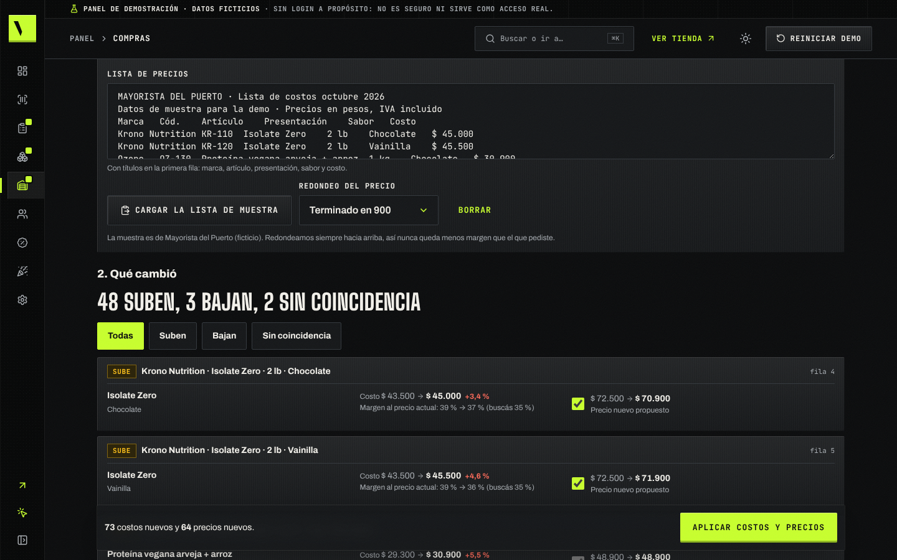
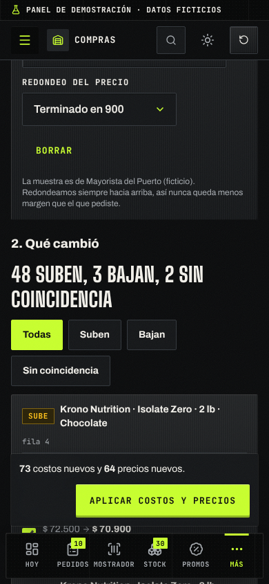
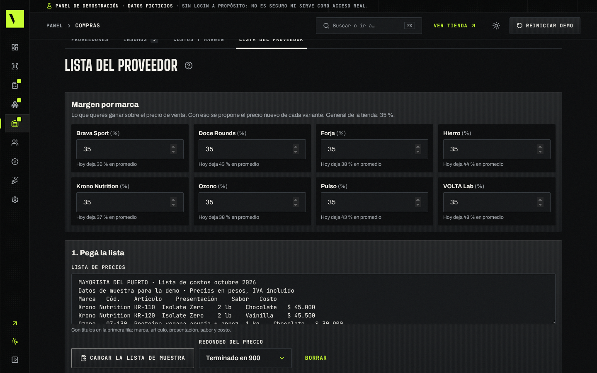
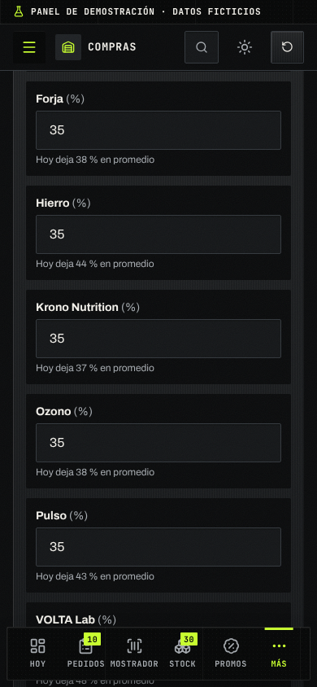
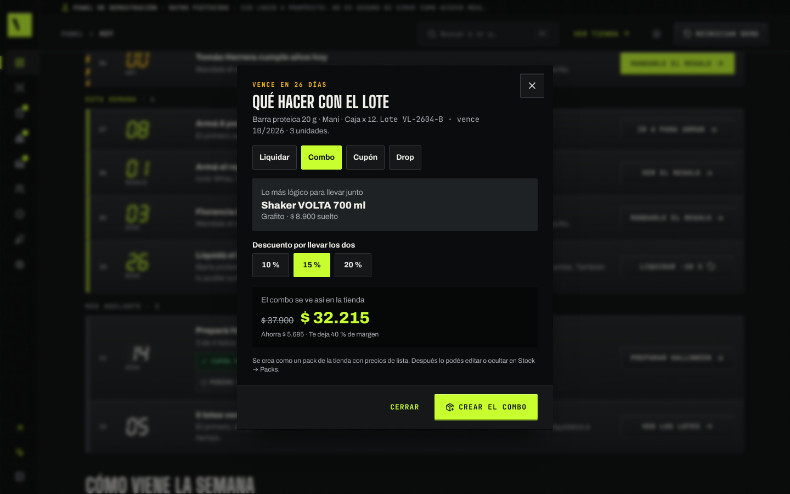
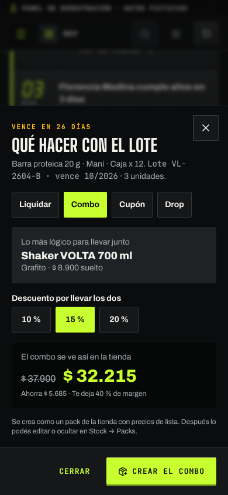

# Guion de 90 segundos · del "Hoy" al modo dueño

Para cuando el dueño tiene dos minutos (en el mostrador, entre cliente y cliente) o como bloque del panel dentro de la
reunión larga ([guion-demo.md](../guion-demo.md)). Va en la **compu o la tablet**; la tienda en el celular queda para la
reunión larga. Todo lo que se nombra existe tal cual en la demo, con la fecha fija del **lunes 5 de octubre de 2026**.
El video del kit ([video/recorrido-kit.webm](video/recorrido-kit.webm)) sigue este mismo orden.

**Antes**: **Reiniciar demo** (arriba a la derecha del panel) y abrí `/admin-demo/`. Modo oscuro. Si la compu tiene
mouse, dejalo a la derecha: la barra lateral se abre al pasar por encima.

## El contraste (decilo antes de tocar nada)

> "¿Hoy usás Tiendanube, una planilla o el WhatsApp? Tiendanube te sube todo un 8 %; esta tienda lee la lista de tu
> distribuidor y sube cada marca con su margen. Y a la mañana te dice qué hacer, en una sola pantalla."

## Bloque por bloque

| Tiempo | Bloque | Qué tocar | Qué decir |
|---|---|---|---|
| 0:00–0:12 | **Hoy en tu tienda** | Abre solo. Señalá el marcador; en **Comprobante de Diego Álvarez** (VOL-000123) tocá **Aprobar** → **Sí, lo verifiqué** | "Tu día en cinco números y la lista de lo que hay que hacer, en orden. Nada queda pagado sin que vos veas la plata." |
| 0:12–0:26 | **Mostrador** | **Mostrador** → buscá "whey vainilla", "creatina", "overvolt" y tocá un pote de cada uno → **Cobrar** → **3 cuotas** → **Registrar venta (simulada)** | "El cliente está adelante: tres potes, descuento stack solo, $ 109.530. En 3 cuotas te dice cuánto paga cada una con el recargo. Y el stock baja del lote que vence primero." |
| 0:26–0:36 | **Pedidos unificado** | **Pedidos → Para armar** → abrí **VOL-000113** → **Escribirle por WhatsApp** | "Los pedidos de la web, del chat y del local en un solo lugar: cobrar, armar, despachar. Y el WhatsApp ya escrito con el estado del pedido." |
| 0:36–0:48 | **Lista del proveedor** | **Compras → Lista del proveedor** → **Cargar la lista de muestra** (Mayorista del Puerto) → arriba dice **48 suben, 3 bajan, 2 sin coincidencia**; tocá **Sin coincidencia** y bajá a **Margen por marca** ("Hoy deja 37 % en promedio") → **Aplicar costos y precios** → **Sí, aplicar** | "Tiendanube te sube todo un 8 %. Acá pegás la lista de tu distribuidor y ves qué sube, qué baja y qué no encontró. Cada marca con su margen: si a Krono le querés sacar 50 %, lo cambiás ahí y el precio propuesto se recalcula. Y el costo nuevo queda con su fecha." |
| 0:48–0:58 | **Lote que vence** | En **Hoy**, la fila **Liquidá el lote VL-2604-B** → **Liquidar −30 %** → la hoja **Qué hacer con el lote**: **Liquidar** (cuánto ganás contra lo que perdés si vence), **Combo** (con el Shaker, **Crear el combo**), **Cupón** (**Crear el cupón** LOTEVL2604B y el WhatsApp a quien lo compró) o **Drop** (**Sumarlo al drop de Halloween**) | "No se te pudre en el estante: te dice cuánto ganás liquidándolo y te deja armado el combo, el cupón o el drop. Un toque y está en la tienda." |
| 0:58–1:06 | **Recompra por WhatsApp** | **Clientes** → arriba, **A quién escribirle hoy** → **Escribirle por WhatsApp** en Paula Castro (o **Copiar el link del bolso**) | "Sabe a quién se le termina el pote por cuántos servicios compró. El mensaje ya está escrito y lleva el link con el bolso cargado: el cliente toca y confirma." |
| 1:06–1:14 | **Campañas y regalos** | **Campañas** (Halloween en 14 días, con su checklist) → **Promos → Regalos y gift cards** | "Las fechas salen solas con su banner y su cupón, y las gift cards con saldo las ves acá. Hasta el regalo de cumpleaños te lo arma Hoy." |
| 1:14–1:26 | **Modo dueño** | Menú del panel → **Ver la tienda en modo dueño** → bajá hasta la placa **Carrusel del inicio** → abrí la ficha de **Ionic Whey** → tocá **Precio y stock de este producto** | "Esto es lo que ve tu cliente. Cada placa te dice qué se cambia desde el panel y te lleva directo: tocás el precio y estás editando ese producto." |
| 1:26–1:30 | **Cierre** | — | "Esto es tu tienda con tu marca. ¿La armamos esta semana?" |

Si aplicaste la lista del proveedor, **Deshacer** (en la misma pantalla de la lista) deja costos y precios como estaban; si querés repetir el recorrido,
**Reiniciar demo**.

## Capturas

| Bloque | Compu | Celular |
|---|---|---|
| Hoy |  |  |
| Aprobar un comprobante |  |  |
| Mostrador: ticket |  |  |
| Mostrador: 3 cuotas |  |  |
| Para armar |  |  |
| Pedido con WhatsApp |  |  |
| Lista del proveedor: qué cambió |  |  |
| Lista del proveedor: margen por marca |  |  |
| Lote que vence: combo armado |  |  |
| Recompra por WhatsApp |  |  |
| Campañas |  |  |
| Regalos y gift cards |  |  |
| Modo dueño: inicio |  |  |
| Modo dueño: ficha |  |  |
| Y te lleva al panel |  |  |

Para regenerarlas: [README.md](README.md).

## Si algo falla

| Pasa esto | Hacé esto |
|---|---|
| El comprobante de VOL-000123 ya no está en Hoy | Ya lo aprobaste antes: **Reiniciar demo** o aprobá el de Sofía Ruiz (VOL-000124) |
| El mostrador no encuentra "overvolt" | Borrá el buscador y escribí "pre"; cualquier pre-entreno sirve para el stack |
| "Liquidar −30 %" ya no está en Hoy | Ya lo liquidaste o armaste algo con ese lote: **Reiniciar demo**, o abrí el lote desde **Stock → Productos y stock** → **N lotes vencen en menos de 60 días** |
| No aparece la franja del modo dueño | Entrá desde el menú del panel (**Ver la tienda en modo dueño**) o sumá `?dueno=1` a la dirección |
| Se te queda prendido el modo dueño en la tienda | Apagá el interruptor **Modo dueño**, o abrí la tienda con `?dueno=0` |
