# Manual del dueño

Cómo se usa el panel de tu tienda en el día a día: qué hace cada sección y cómo hacer cada tarea, paso a paso. Está
escrito con la tienda de ejemplo **VOLTA**; en tu tienda vas a ver tu marca, pero los botones son los mismos.

> **Estás en la demo.** Todo lo que hagas queda guardado solo en el equipo y el navegador que estás usando, con datos
> inventados. Nada se cobra, no sale ningún email ni mensaje y nadie más ve tus cambios. **Reiniciar demo** deja todo
> como al principio. Cada sección te avisa qué es simulado.

## Índice

1. [Cómo moverte por el panel](#1-cómo-moverte-por-el-panel)
2. [Hoy en tu tienda: tu día en una pantalla](#2-hoy-en-tu-tienda-tu-día-en-una-pantalla)
3. [Pedidos: cobrar, armar, despachar y posventa](#3-pedidos-cobrar-armar-despachar-y-posventa)
4. [Clientes y recompra](#4-clientes-y-recompra)
5. [Productos, stock y lotes](#5-productos-stock-y-lotes)
6. [Importar la lista del proveedor (o tu catálogo)](#6-importar-la-lista-del-proveedor-o-tu-catálogo)
7. [Aumentar precios](#7-aumentar-precios)
8. [Para armar, despachos y calendario](#8-para-armar-despachos-y-calendario)
9. [Proveedores, compras, costos e insumos](#9-proveedores-compras-costos-e-insumos)
10. [Emails automáticos](#10-emails-automáticos)
11. [Cupones, ruleta, juego, misiones y descuento stack](#11-cupones-ruleta-juego-misiones-y-descuento-stack)
12. [Campañas](#12-campañas)
13. [Estudio de contenido (Instagram)](#13-estudio-de-contenido-instagram)
14. [Contenido de la tienda](#14-contenido-de-la-tienda)
15. [Ajustes](#15-ajustes)
16. [Una rutina que funciona](#16-una-rutina-que-funciona)
17. [Qué es simulado en la demo](#17-qué-es-simulado-en-la-demo)

### Palabras que vas a ver

| Palabra | Qué quiere decir |
|---|---|
| Variante | Cada combinación de sabor y tamaño de un producto (Ionic Whey Chocolate 2 lb es una variante) |
| Servicio | Una toma (un scoop, una cápsula). El precio por servicio es lo que le sale cada toma a tu cliente |
| Lote | El código y el mes de vencimiento que trae cada tanda de potes |
| Stack | Varios suplementos que se toman juntos (proteína + creatina + pre). Con varias categorías hay descuento |
| Recompra | Cuando a un cliente se le está por terminar el pote y le conviene volver a comprar |
| Segmento | Un grupo de clientes que el panel arma solo (nuevos, VIP, a los que se les termina esta semana…) |

---

## 1. Cómo moverte por el panel

El panel de la demo está en la dirección de tu tienda + `/admin-demo/`. En la tienda real entrás con tu usuario y
contraseña.

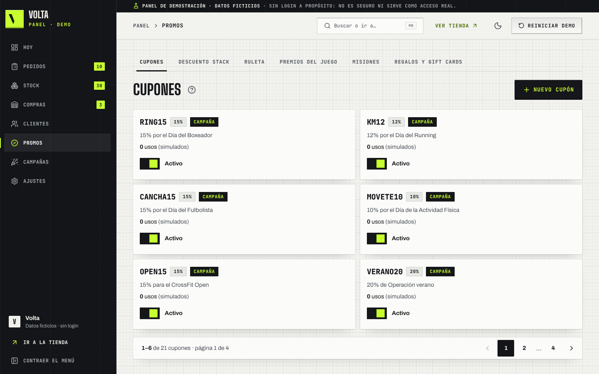

**En la compu**
- A la izquierda está el menú, con **8 entradas**: **Hoy**, **Pedidos**, **Stock**, **Compras**, **Clientes**,
  **Promos**, **Campañas** y **Ajustes**. Se abre al pasar el mouse por encima. El número verde avisa cuánto hay para
  atender en esa sección (comprobantes, pedidos atrasados, stock bajo).
- Cada entrada tiene sus **pestañas** arriba de la pantalla (por ejemplo, Promos: Cupones, Descuento stack, Ruleta,
  Premios del juego, Misiones, Regalos y gift cards). Se recorren con el mouse, el dedo o las flechas del teclado.
- Cada pantalla abre con un título corto. El **?** que está al lado te explica qué hace y qué es simulado.
- Arriba: **Buscar o ir a…** (también con Ctrl+K) para abrir un pedido, un cliente o una sección escribiendo; **Ver
  tienda**; el sol/luna para el modo claro u oscuro; y **Reiniciar demo**.

**En el celular**

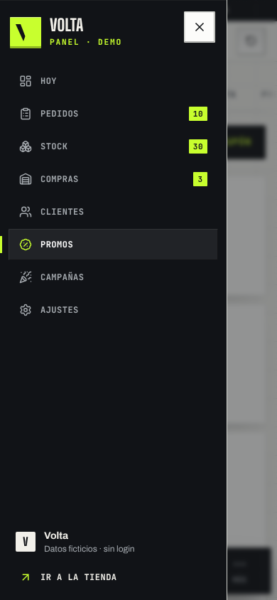

- Abajo tenés las pestañas **Hoy**, **Pedidos**, **Stock**, **Promos** y **Más** (el resto de las secciones). Las
  pestañas de cada sección se deslizan hacia los costados.
- Arriba, el menú (☰), el buscador, el modo claro/oscuro y Reiniciar demo (la flecha circular).

### Dónde quedó cada pantalla

Antes el menú tenía 21 entradas. Ahora son 8 y lo que era una entrada pasó a ser una pestaña dentro de su sección.
Los enlaces viejos siguen andando: te llevan a la pestaña nueva.

| Sección | Pestañas | Antes era |
|---|---|---|
| **Hoy** | (una sola pantalla) | Inicio |
| **Pedidos** | Por cobrar · Para armar · Despachos (Lista y hoja de ruta, Calendario) · Postventa (Seguimiento, Reclamos) · Todos | Pagos manuales (ahora **Por cobrar**), Preparación y la vieja Producción (ahora **Para armar**), Calendario de despachos (dentro de **Despachos**), Reclamos (dentro de **Postventa**) y la tabla de Pedidos (ahora **Todos**) |
| **Stock** | Productos y stock · Categorías · Packs · Importar | Productos y stock (con Stock y Planilla adentro), Categorías y objetivos, Packs, Importar desde Excel |
| **Compras** | Proveedores · Insumos · Costos y margen | Proveedores y compras, Insumos de embalaje, Costos y margen |
| **Clientes** | (una sola pantalla, con la ficha de cada cliente) | Clientes |
| **Promos** | Cupones · Descuento stack · Ruleta (Configuración y Premios disponibles) · Premios del juego · Misiones (y Simular progreso) · Regalos y gift cards | Cupones y ruleta (una pantalla con tarjetas), Descuento stack, Misiones, Regalos y gift cards |
| **Campañas** | Campañas · Estudio de contenido | Campañas (antes Temáticas), Estudio de contenido, y el resumen de Marketing |
| **Ajustes** | Contacto · Medios de pago · Datos de cobro · Envíos y retiro · Contenido (Carrusel, Textos de inicio, Preguntas frecuentes) · Emails (Emails automáticos, Bandeja de salida) | Ajustes (una pantalla con tarjetas), Contenido, Emails automáticos |

Qué cambia en las direcciones: `/admin-demo/cupones/` y `/admin-demo/cupones/lista/` ahora son `/admin-demo/promos/`;
`/admin-demo/marketing/` y `/admin-demo/tematicas/` llevan a **Campañas**; `/admin-demo/contenido/` lleva al carrusel y
`/admin-demo/ajustes/contacto/` a **Ajustes**; `/admin-demo/produccion/` lleva a **Para armar** y `/admin-demo/stock/` y
`/admin-demo/planilla/` a **Productos y stock** (vista por variante y formato Excel). En Pedidos las direcciones de
antes abren la pestaña nueva con sus filtros: `/admin-demo/pagos/` es **Por cobrar** (`?estado=done` sigue mostrando los
resueltos), `/admin-demo/preparacion/` es **Para armar**, `/admin-demo/calendario/` es **Despachos → Calendario**,
`/admin-demo/reclamos/` es **Postventa → Reclamos** y `/admin-demo/pedidos/` es **Todos**. Son nuevas
`/admin-demo/despachos/` y `/admin-demo/postventa/`. El resto de las direcciones no cambió.

> Mostrador (la venta en el local) se suma como novena entrada, en el centro de las pestañas del celular.

**Tablas**: casi todas las listas (pedidos, clientes, productos, costos…) tienen buscador, filtros, **Reiniciar**
filtros, **Columnas** para elegir qué ver, **Ver en formato Excel** y **Descargar Excel (.xlsx)** con lo que estás
filtrando.

---

## 2. Hoy en tu tienda: tu día en una pantalla

Es lo primero que ves al abrir el panel. La idea: que a la mañana, en 30 segundos, sepas qué hacer hoy.

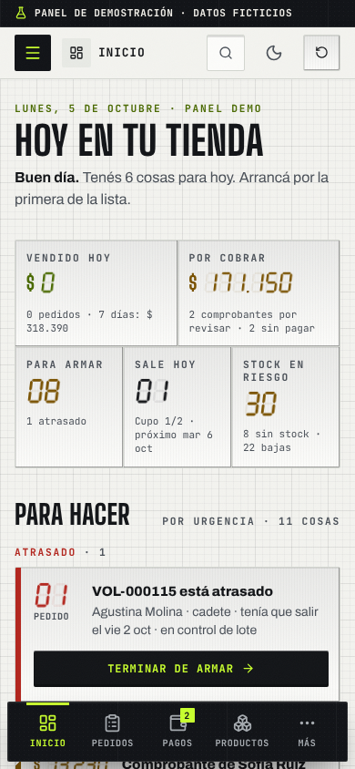

**El marcador de arriba** (tocá cualquier número y te lleva a donde vive):

| Número | Qué cuenta |
|---|---|
| **Vendido hoy** | Pedidos de hoy ya pagados. Debajo, lo vendido en los últimos 7 días. Un comprobante sin aprobar no suma |
| **Por cobrar** | Lo que todavía no cobraste: pedidos sin pagar y comprobantes que tenés que revisar |
| **Para armar** | Pedidos pagados o en preparación, y cuántos están atrasados |
| **Sale hoy** | Pedidos con el cadete de hoy, el cupo que le queda y el próximo día que tiene lugar (te lleva a **Despachos**) |
| **Stock en riesgo** | Variantes sin stock o con 3 unidades o menos |

**Para hacer** es la lista del día, ya ordenada. Va de arriba hacia abajo en cuatro grupos: **Atrasado**, **Para hoy**,
**Esta semana** y **Más adelante**. Dentro de cada grupo va primero lo que tiene a un cliente esperando (pedidos y
comprobantes) y después lo que vence antes. Cada fila tiene **un solo botón**:

| Fila | Botón | Qué pasa |
|---|---|---|
| Pedido atrasado o que sale hoy | **Terminar de armar** / **Armar** | Te abre **Para armar** en ese pedido |
| Comprobante de un cliente | **Aprobar** | Te pregunta si ya viste la plata en tu cuenta. Recién con **Sí, lo verifiqué** el pedido pasa a Pagado y se va de la lista. Si no entró, tocá el nombre del comprobante: se abre **Por cobrar** en ese pedido para verlo y rechazarlo |
| Pedido listo que sale hoy | **Marcar enviado** (o **Marcar retirado**) | Te pide confirmar y el pedido pasa a Enviado o Entregado |
| Compras a proveedores | **Armar los pedidos** | Te lleva a **Proveedores y compras**. Si hay variantes sin stock, es para hoy |
| Clientes a los que se les termina el pote | **Avisarles** | Se abre la lista con el aviso por email o WhatsApp de cada uno. Los que avisás dejan de contar |
| Pedidos de la semana | **Ir a Para armar** | Te lleva a **Pedidos → Para armar** |
| Regalo con el sabor ya elegido | **Ver el regalo** | Te lleva al regalo en **Regalos y gift cards**: es lo que tenés que armar |
| Lote que vence en 30 días o menos | **Liquidar −30 %** | Abre la liquidación con el descuento propuesto (40 % si faltan 15 días o menos). Liquidado, sale de la lista. Un lote vencido aparece arriba de todo para sacarlo de la venta |
| Próxima campaña | **Preparar** | Te abre el editor. Debajo, el checklist: cupón activo, productos con stock, descuento real y piezas para Instagram |
| Otros lotes que vencen en 60 días | **Ver los lotes** | Te lleva a Productos y stock con el filtro de vencimientos |

Cuando no queda nada atrasado ni para hoy, arriba de la lista aparece **Todo al día**.

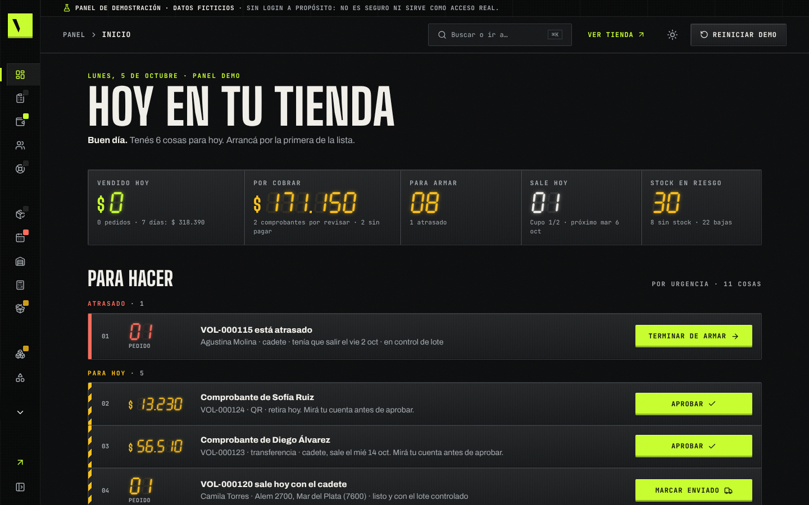

Al final, **Cómo viene la semana**: las ventas por día. Tocá una barra para ver los pedidos de ese día.

> En la demo: el día está fijo en el lunes 5 de octubre de 2026 y aprobar, despachar o avisar solo cambia los datos de
> este navegador. Nada se cobra ni se manda.

---

## 3. Pedidos: cobrar, armar, despachar y posventa

**Pedidos** está ordenado por lo que tenés que hacer, de izquierda a derecha: **Por cobrar**, **Para armar**,
**Despachos**, **Postventa** y, al final, **Todos** (la tabla con todos los pedidos). Al tocar **Pedidos** en el menú
entrás a **Por cobrar**. En cada pantalla ves el **total** de cada pedido y el botón **Escribirle por WhatsApp**, que
abre WhatsApp con el mensaje del estado del pedido ya escrito, al teléfono del cliente (sección 10).

### Los estados de un pedido

Pendiente de pago → Comprobante en revisión → Pagado → En preparación → Listo → Enviado → Entregado. Además, un
pedido puede quedar **En reclamo** o **Cancelado**. Cada cambio queda en el historial del pedido y, si corresponde,
le manda al cliente su email (sección 10). El WhatsApp no sale solo: lo mandás vos con el botón.

### Por cobrar: los comprobantes, de a uno

Cuando el cliente paga por transferencia o QR, sube el comprobante y el pedido queda **Comprobante en revisión**.
Subir un comprobante **nunca** marca el pedido como pagado: lo aprobás vos.

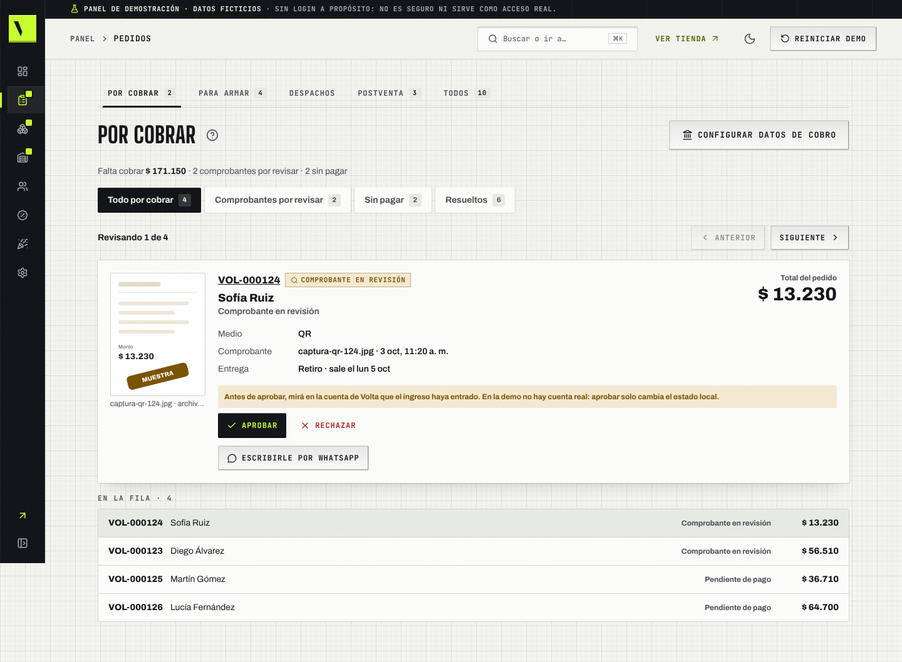

1. Entrá a **Pedidos → Por cobrar** (o tocá **Por cobrar** en el marcador de Hoy). Arriba dice cuánto falta cobrar.
2. Se revisa **de a uno**: primero los comprobantes que subieron tus clientes y después los pedidos que todavía no se
   pagaron. Ves el comprobante, el **total del pedido**, el medio y cuándo sale. **Anterior** y **Siguiente** te mueven;
   abajo, en **En la fila**, tocás cualquiera para ir directo.
3. Fijate en tu banco o billetera que la plata haya entrado.
4. Si entró: **Aprobar** → te pregunta "¿Ya viste en tu cuenta el ingreso de …?" → **Sí, lo verifiqué**. El pedido
   pasa a Pagado, entra en **Para armar** y al cliente le llega "Pago aprobado". En la pantalla aparece el que sigue.
5. Si no coincide: **Rechazar**, escribí el motivo (por ejemplo "El monto no coincide") y confirmá. El cliente recibe
   el motivo y cómo mandar otro; el pedido vuelve a **Sin pagar** y su WhatsApp ya dice el motivo.
6. Un pedido **Sin pagar** que el cliente no va a pagar: **Cancelar el pedido**. Para recordarle que pague,
   **Escribirle por WhatsApp**.
7. En **Resueltos** queda todo lo que ya revisaste, con su motivo. **Configurar datos de cobro** cambia el alias y el
   CBU que ve el comprador.

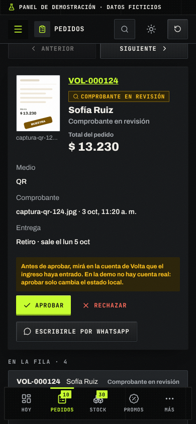

> En la demo: no hay cuenta bancaria real. Aprobar solo cambia el estado en tu navegador. Los pagos con Mercado Pago
> no llevan comprobante: en la tienda real se confirman solos (en la demo, **Simular confirmación de Mercado Pago**).

**Para armar** y **Despachos** están en la sección 8.

### Postventa: lo que ya salió

En **Pedidos → Postventa → Seguimiento** está lo que pasa después del despacho:

- **En camino**: lo que salió con el cadete o el correo. Cuando llega, **Marcar entregado** (al cliente le llega el
  email "así se toma").
- **En reclamo**: el pedido y el reclamo o la devolución que tiene abierto.
- **Entregados hace poco** (últimos 30 días): **Escribirle por WhatsApp** para saber cómo le fue.

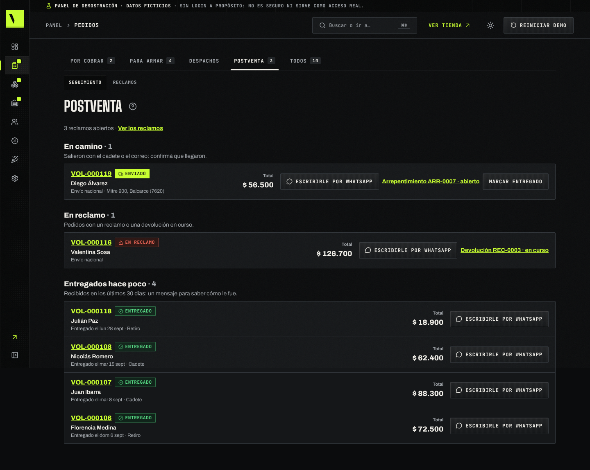

**Reclamos, devoluciones y arrepentimientos** están al lado, en **Postventa → Reclamos**:
1. En **Pendientes** están los abiertos (arrepentimiento, devolución o reclamo).
2. Tocá uno para ver el mensaje del cliente y su pedido.
3. Usá **Marcar en curso** mientras lo resolvés, y después **Resolver** o **Rechazar**.

Los arrepentimientos que el cliente manda desde el botón de arrepentimiento de la tienda aparecen acá solos.

### Todos los pedidos y la ficha de un pedido

1. Entrá a **Pedidos → Todos**. Filtrá por **Etapa** (Por cobrar, Por preparar, En preparación, Listos…) o buscá por
   código o cliente. El ícono de WhatsApp de cada fila abre el mensaje de su estado.
2. Tocá la fila del pedido (por ejemplo **VOL-000123**).
3. Arriba ves el estado del pago, el de la preparación, el total, **Escribirle por WhatsApp** y la **Próxima acción**
   (qué tenés que hacer vos).
4. Más abajo: el cliente, los productos con el **lote que sale** de cada uno, el pago, la entrega, el historial, las
   notas internas y los emails que ya le llegaron.

**Cambiar el estado**: en la ficha, tocá el botón del estado siguiente (por ejemplo **En preparación**) y confirmá.
Para pasar a **Listo** te pide el control de lote (sección 8). Para cambiar varios pedidos juntos: en **Todos**, tildá
los pedidos y usá la acción en lote que aparece (por ejemplo **Pasar a En preparación**).

**Fecha de despacho**: en la ficha, **Fecha comprometida de despacho** → elegí el día → **Guardar**. **Ver la
capacidad en el calendario** te muestra si el cadete tiene lugar ese día.

**Notas internas**: escribí en **Nueva nota (no la ve el comprador)** y tocá **Agregar nota**. Sirve para "pidió
cambiar a chocolate" o "retira el jueves".

---

## 4. Clientes y recompra

En **Clientes** está cada persona que te compró, con o sin cuenta, unida por su email.

### Saber a quién escribirle esta semana

1. Entrá a **Clientes**.
2. En **Segmento** elegí **Se le termina esta semana**.
3. Vas a ver a quién se le termina el pote y cuál (columna **Se le termina**). Tocá el nombre para abrir su ficha.

Otros segmentos útiles: **Recompra atrasada** (ya se le terminó y no volvió), **Nuevos**, **Frecuentes**, **VIP** y
**Sin compras**. También podés filtrar por **Objetivo** (masa muscular, fuerza, definición…).

### Avisarle que se le está por terminar

1. Abrí la ficha del cliente (por ejemplo **Juan Ibarra**).
2. En **Se le termina** ves cada pote con su batería y la fecha: "Se le termina el jueves 8 de octubre (en 3 días)".
   El cálculo sale de los servicios del pote y de cuándo lo recibió (un servicio por día; pre-entrenos y aminoácidos,
   4 por semana). Es orientativo.
3. Tocá **Avisarle por email** o **WhatsApp** (abre WhatsApp con el mensaje ya escrito).
4. Queda marcado "Avisado por email" y no se repite para ese pote. Lo que se termina más adelante dice "Avisale desde
   el…".

Lo mismo podés hacer desde **Hoy en tu tienda** → **Avisarles**, sin entrar a cada ficha.

### Lo que ve el cliente: avisos y "Mi box"

El cliente no tiene que pedir nada: la misma cuenta corre de su lado.

- En la **ficha de entrega** (la pantalla que ve al confirmar la compra) toca **Activar avisos de recompra** y queda
  un aviso por pote, 5 días antes de que se termine, contado desde el día que lo recibe.
- En **Mi cuenta → Mi box** ve sus potes en uso como **baterías** que se descargan solas a partir de sus pedidos
  pagados, con **Recomprar** en cada uno, **Repetir mi último pedido** y su **nivel del club** con la barra de lo que
  le falta. En **Mis pedidos** cada pedido tiene **Seguir** y **Repetir**.

**En la ficha también**: el historial de compras, el **Objetivo** (si no lo cargás, se deduce de lo que compra), el
cumpleaños y notas internas (**Nota nueva** → **Guardar nota**).

> En la demo: el email queda en la **Bandeja de salida** (sección 10) y el WhatsApp no se manda solo: se abre para que
> lo envíes vos.

---

## 5. Productos, stock y lotes

En **Stock → Productos y stock** tenés el catálogo entero. Arriba, dos avisos: **lotes que vencen en menos de 60 días** y
**variantes que necesitan reposición**. Con **Productos** ves un renglón por producto; con **Variantes**, uno por
sabor y tamaño, con su stock.

### Cargar o editar un producto

1. Tocá **Nuevo producto**, o **Editar** en el renglón de un producto.
2. Completá los pasos: foto (o el envase dibujado), nombre y descripción, categoría, **presentaciones** (sabor,
   tamaño, **precio final** de cada una, servicios y costo del proveedor: el precio por servicio y el margen se calculan
   mientras escribís), **rótulo** (tabla nutricional, modo de uso, leyenda y RNPA), marca, objetivos, sellos (sin TACC,
   vegano…) y medidas de envío. Un suplemento no se guarda sin RNPA (formato 00-000000: si lo copiás del envase, el
   panel lo acomoda solo) ni sin porción y proteína en la tabla. El equipamiento no lleva rótulo ni servicios.
   En **Qué elige el cliente** decidís cómo se llaman las opciones en la tienda: **sabor y tamaño** (suplementos),
   **color y talle** (cinturones, rodilleras) o **color y medida** (guantes, sogas, botellas).
3. En cada variante de un suplemento cargá sus **lotes**: código, mes de vencimiento y unidades. El stock es la suma de
   los lotes y **sale primero el que vence primero** (lo marca como "Sale primero"). El equipamiento (categorías de
   accesorios de gym, boxeo y shakers) no vence: lleva stock por color y talle, sin lotes.
4. Tocá **Guardar**. Te avisa si falta algo (por ejemplo, un lote con unidades pero sin código).

**Pausar un producto**: apagá el interruptor **Visible** en su renglón. Deja de verse en la tienda sin borrarlo.

**Ver cómo queda**: **Ver** en el renglón o **Ver en tienda** desde el editor.

**Precio por servicio y margen**: la lista de **Productos y stock** tiene esas dos columnas (por producto, el rango de
sus presentaciones). El margen usa el costo de la presentación o el de **Costos**; si es una estimación, lo dice.

**En la tienda**: la ficha muestra primero el **precio total** y abajo, chico, cuánto sale cada servicio y cuánto te
dura. El catálogo se filtra por objetivo, marca, sabor, sellos y precio por servicio, y se ordena por **Más rendidor** o
**Más proteína por $**. Con **Comparar** en cada tarjeta, el cliente pone 2 o 3 productos lado a lado (y puede mandar la
comparación como imagen): la respuesta que hoy escribís por WhatsApp.

### Liquidar un lote que está por vencer

1. En **Productos y stock** tocá **6 lotes vencen en menos de 60 días** (el número cambia) o **Liquidar** en la fila
   del lote en **Hoy en tu tienda** (ya viene con el descuento propuesto).
2. Tocá **Liquidar** en el lote (por ejemplo VL-2603-W de Ionic Whey Vainilla, que vence en 56 días).
3. Elegí el descuento (−10 % a −50 %, u otro porcentaje) y mirá cómo se va a ver en la tienda.
4. Tocá **Liquidar a $ …**.

En la tienda ese sabor sale con el precio tachado y "Liquidación · vence 11/2026". Para volver atrás: en el lote,
**Cambiar la liquidación** → **Quitar liquidación**.

### Categorías y objetivos

En **Categorías y objetivos** ordenás las categorías (**Subir**/**Bajar**), elegís las destacadas y editás los
**objetivos** (Masa muscular, Fuerza, Energía…): nombre, color, bajada y el **Producto destacado**, que va en el stack
de ese objetivo en el inicio, con un link a su ficha. Tocá **Guardar objetivos**. La tienda, el quiz y Armá tu stack usan
esos nombres.

Más abajo están los **Deportes** (Fútbol, Tenis, Pádel, Running…): nombre, color, bajada y el **Pack sugerido**, que
aparece como "Ver Pack X" en la tarjeta del deporte del inicio. Qué objetivos suma cada deporte (por ejemplo, Fútbol
suma resistencia y recuperación) y su equipamiento vienen armados. Tocá **Guardar deportes**.

---

## 6. Importar la lista del proveedor (o tu catálogo)

Para cuando te llega la lista nueva de la distribuidora, o para cargar tu catálogo de una vez desde Excel.

1. En **Productos y stock** tocá **Importar Excel**.
2. Arrastrá tu archivo (Excel o .csv) o tocá **Elegir archivo**. El archivo no se sube a ningún lado: se lee en tu
   equipo.
3. El panel reconoce si es tu catálogo o una **Lista de un proveedor** y te muestra qué columna es cada cosa (costo,
   precio sugerido, sabor, presentación…). Corregí lo que haga falta.
4. Tocá **Ver vista previa**. Ves cuántas filas **Se actualiza**, cuáles quedan **Sin cambios**, cuáles **No lo
   vendés** y cuáles tienen **error** (con el motivo: "No encontramos la presentación…").
5. Revisá **Con cambios**: costo nuevo, precio viejo → nuevo y margen.
6. Tocá **Actualizar 14 filas** (el número es el de tu lista). Listo: "Costos y precios al día".

**Si te equivocaste**: **Deshacer importación** y confirmá. Vuelve todo como estaba.

**Para probar sin tu archivo**: **Probar con la lista de un proveedor** (una distribuidora inventada) o **Probar con
una planilla de ejemplo** (como la que muchos locales tienen hoy). Con **Bajar mi catálogo como plantilla** te llevás
un Excel con todos tus productos para editarlo y volver a subirlo.

---

## 7. Aumentar precios

Para subir (o bajar) un porcentaje a una marca, una categoría o todo el catálogo, viendo cada precio antes.

1. En **Productos y stock** tocá **Aumentar precios**.
2. Elegí **Una marca**, **Una categoría** o **Todo el catálogo**, y cuál.
3. Escribí el **Porcentaje** (con signo menos baja: −10) y el **Redondeo** (por ejemplo, a $100).
4. Mirá la lista: precio actual → precio nuevo de cada variante ("9 variantes cambian de precio, en 4 productos").
5. Tocá **Aplicar a 9 variantes** y confirmá con **Sí, aplicar**.

La tienda ya muestra los precios nuevos. **Deshacer aumento** vuelve exacto al precio anterior (el último aumento).

---

## 8. Para armar, despachos y calendario

### Para armar: dos pasos por pedido

En **Pedidos → Para armar** están los pedidos pagados, el que sale antes primero (los atrasados, con borde rojo). Cada
pedido tiene su checklist de **dos pasos**, sin columnas ni arrastrar:

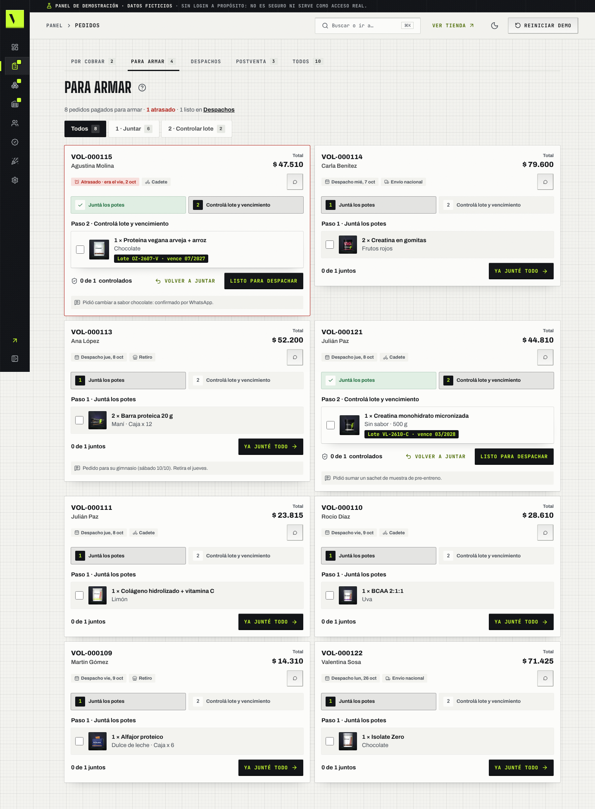

1. **Juntá los potes**: tildá cada producto a medida que lo sacás del estante (si salís de la pantalla, lo tildado
   queda). Con todo tildado, **Ya junté todo**: el pedido pasa a "En preparación", se descuenta su embalaje (una sola
   vez) y al cliente le llega "Preparando tu pedido".
2. **Controlá lote y vencimiento**: cada producto muestra el lote que tiene que salir (el que vence primero, por
   ejemplo **Lote VL-2604-B · vence 10/2026**). Fijate que coincida con la etiqueta y tildalo. Abajo dice "1 de 1
   controlados". **Listo para despachar**: sin todos los lotes tildados no te deja. Si falta un pote, **Volver a
   juntar** te lleva al paso 1.

Arriba podés filtrar por **1 · Juntar** o **2 · Controlar lote**. El total y el WhatsApp del pedido están en cada
tarjeta. Desde Hoy, **Armar** te abre directo el pedido.

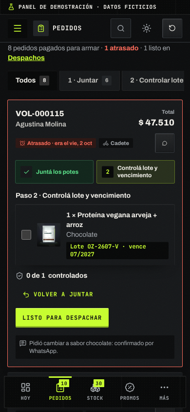

El lote queda anotado en el pedido ("Lote controlado: VL-2604-B · vence 10/2026") y al cliente le llega solo el email
de "listo para retirar" o "listo para salir", según cómo lo recibe. Desde ese momento, en el **seguimiento** de su
pedido cada producto muestra su etiqueta **LOTE VL-2604-B · VTO 10/2026**: antes del control dice "Lote: se controla
al armar tu pedido". Es la prueba de que vende originales y con fecha, sin que nadie pregunte por WhatsApp.

### Despachos: lista de armado y hoja de ruta del cadete

En **Pedidos → Despachos → Lista y hoja de ruta** elegís el día (**Hoy**, **Mañana** y los próximos días hábiles, cada
uno con cuántos pedidos salen). Lo atrasado se suma a hoy.

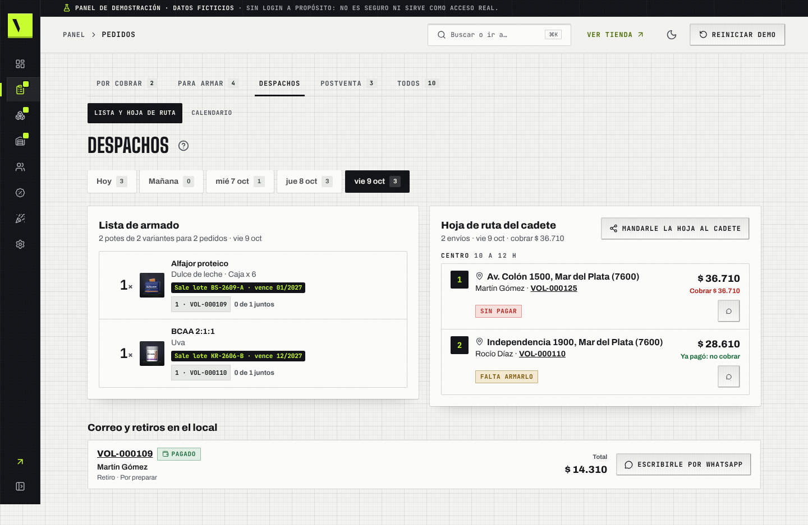

- **Lista de armado**: cuántos potes de cada variante tenés que juntar para todos los pedidos pagados que salen ese día
  (por ejemplo "2× Barra proteica · Maní"), con el lote que sale y de qué pedidos son. Lo que ya está junto se marca.
- **Hoja de ruta del cadete**: los envíos en Mar del Plata ordenados por zona y franja (Centro de 10 a 12 h, Playa
  Grande y Los Troncos de 12 a 14 h…), con la dirección, el total y **qué cobrar** ("Ya pagó: no cobrar" o "Cobrar $ …"
  si todavía no pagó). Cuando se lo das al cadete, **Marcar enviado**. **Mandarle la hoja al cadete** abre WhatsApp con
  el recorrido escrito.
- **Correo y retiros en el local**: lo que sale ese día sin cadete.

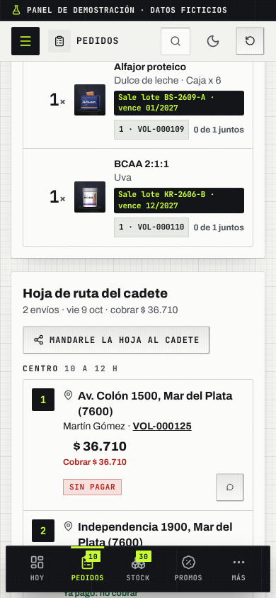

### Calendario de despachos

En **Pedidos → Despachos → Calendario** ves cada pedido en el día que sale: con el cadete en Mar del Plata, por correo
o para retirar.

- **Mes**, **Semana** o **Agenda** para cambiar la vista. Los días con el cadete lleno dicen **Completo**.
- **Reprogramar**: arrastrá el pedido a otro día (te pide confirmar) o tocalo y elegí, por ejemplo, **Día hábil
  siguiente**. La fecha nueva queda en el pedido.
- **Cupo del cadete y feriados**: cuántos envíos hace el cadete por día (2 en la demo), feriados y días sin despacho.
- Tocá un día para ver lo que sale o agregar una tarea o recordatorio ("Recibir la entrega de Krono Nutrition").

---

## 9. Proveedores, compras, costos e insumos

### Qué comprar y a quién

En **Compras → Proveedores**, la pestaña **Compra sugerida** junta lo que hay que reponer, agrupado por distribuidora,
con el total al costo, la próxima entrega y si llegás al pedido mínimo.

1. Revisá la tarjeta del proveedor (por ejemplo **Sur Suplementos**).
2. Tocá **Copiar pedido para WhatsApp** y pegalo en el chat del proveedor ("Hola Germán, ¿cómo va? Te paso el
   pedido…"). Con **Ver el mensaje** lo leés antes.
3. Tocá **Marcar como pedido**. Deja de sugerirse y pasa a **Pedidos hechos**.
4. Cuando llega la mercadería: **Recibir mercadería** → **Sumar al stock**.

**Stock mínimo**: en esa pestaña ponés, para cada variante, cuántas unidades querés tener como mínimo. Si baja de ahí,
aparece en la compra sugerida. **Proveedores**: los datos de cada distribuidora (contacto, días de reparto, pedido
mínimo).

> En la demo: los proveedores son inventados y el pedido no se manda solo; lo copiás vos.

### Costos y margen

En **Costos y margen** ves cuánto te cuesta cada producto (lo que le pagás al proveedor más el embalaje), cuánto te
deja al precio actual y el precio sugerido para tu **Margen objetivo (%)**. El filtro **Margen bajo o pérdida** te
muestra lo que conviene revisar. Tocá un producto para ver el margen de cada presentación.

### Insumos de embalaje

En **Insumos de embalaje**: cajas, bolsas, precintos, folletos, cinta y los regalos que sumás a los pedidos (sachets,
shakers). Te dice cuánto hay, cuánto piden los pedidos pagados y qué **Reponer**. Para agregar uno: **Nuevo insumo**.

---

## 10. Emails automáticos

Está en **Ajustes → Emails** (con la **Bandeja de salida** al lado). Un email en cada momento del pedido (compra recibida, comprobante recibido, pago aprobado, pago no validado,
preparando, listo para retirar, listo para salir, en camino, entregado con "así se toma") y el aviso de **Tu pote se
está por terminar**. Salen solos cuando cambiás el estado del pedido.

**Pausar uno**: en **Emails automáticos**, apagá **Se envía solo** en su tarjeta.

**Cambiar el texto**:
1. Tocá **Editar** en la tarjeta (por ejemplo **Pago aprobado**).
2. Cambiá el asunto y los textos. Para poner un dato del pedido (nombre del cliente, total, fecha de entrega) tocá el
   texto y después **Insertar …**: en cada email se reemplaza por el dato real.
3. Elegí un pedido en **Con el pedido** para ver la vista previa con datos reales, en **Escritorio** o **Celular**.
4. **Enviar prueba** y después **Guardar cambios**. **Restaurar** vuelve al texto original.

**Versión WhatsApp**: cada email tiene al lado su mensaje corto de WhatsApp, el que se abre con **Escribirle por
WhatsApp** en Pedidos. En la tarjeta del email lo ves armado con un pedido real; **Editar WhatsApp** (o la sección
**Versión WhatsApp** dentro del editor del email) lo cambia con las mismas fichas de datos (**Insertar Nombre del
cliente**, **Total del pedido**…) y **Guardar WhatsApp**. **Volver al de muestra** deshace los cambios. Los estados que
no mandan email (**En reclamo**, **Cancelado** y **Devuelto**) tienen solo su WhatsApp, en **Solo por WhatsApp**.

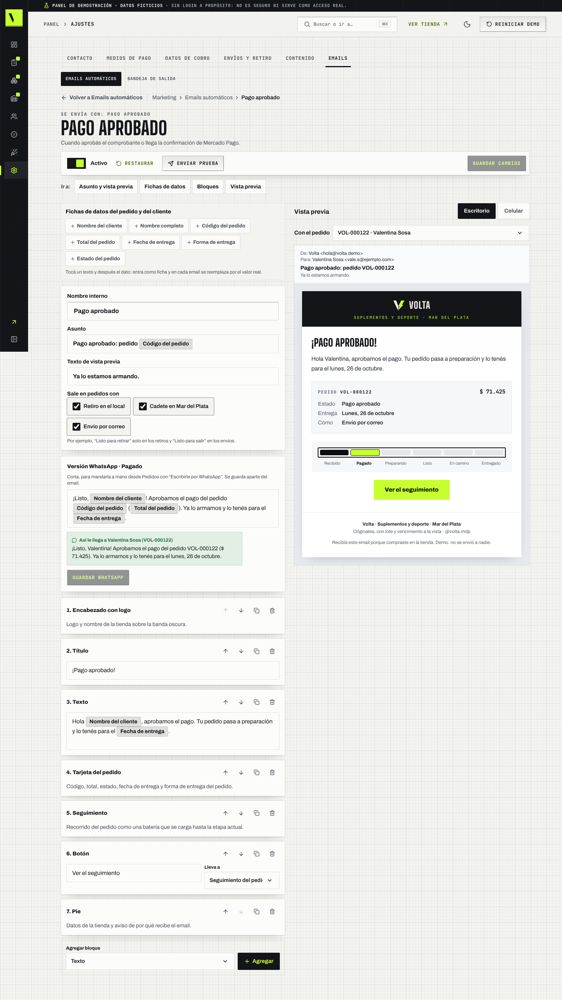

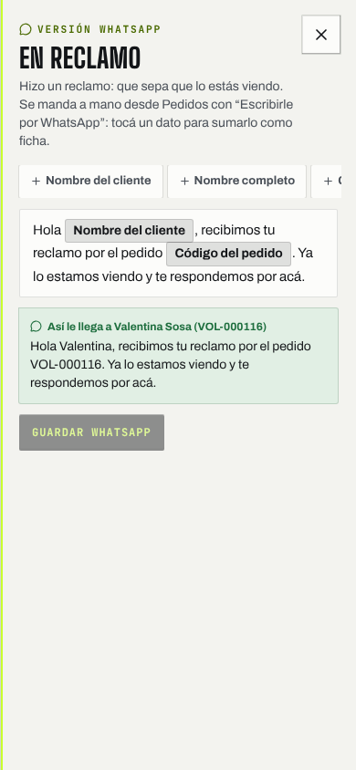

**Bandeja de salida**: todos los emails que "salieron", con buscador y filtro por **Momento**.

> En la demo: no sale ningún email. Todo queda en la Bandeja de salida para que lo veas. El WhatsApp se abre con el
> mensaje escrito y lo mandás vos; los mensajes editados quedan solo en este navegador.

---

## 11. Cupones, ruleta, juego, misiones y descuento stack

Todo está en **Promos**, con una pestaña por herramienta.

**Cupones** (Promos → **Cupones**)
1. Tocá **Nuevo cupón**.
2. Escribí el **Código** (de 3 a 20 letras o números, por ejemplo FERIA15) y el **Valor**. Si querés: **Compra
   mínima**, **Usos totales** y **Solo con cuenta**.
3. Tocá **Crear cupón**. Ya funciona en el carrito. Lo pausás con el interruptor **Activo**.

**Ruleta** (Promos → **Ruleta** → **Configuración**): si se ve en la tienda, cuántos días dura el premio y los
gajos. Cada gajo tiene un **Premio** y un **Peso**: cuanto más peso, más sale (ves el porcentaje al lado). Tocá
**Guardar ruleta**. Los premios se eligen de **Premios disponibles** (la otra subpestaña de Ruleta).

**Premios del juego Shaker Rush** (Promos → **Premios del juego**)

1. Cada nivel tiene **Desde (puntos)**, el **Premio** (porcentaje, monto fijo o envío gratis) y **Vence en (días)**.
2. Con **Probá un puntaje** ves qué gana alguien con, por ejemplo, 800 puntos.
3. **Agregar nivel** (hasta 5) o quitar uno con el tachito.
4. Tocá **Guardar premios**. **Se entregan cupones** apagado pausa los premios (el juego sigue).

El cupón del juego se gana **una vez por día**; se juega todas las veces que quieran.

**Misiones** (Promos → **Misiones**; **Simular progreso** es su otra subpestaña): retos para el Club ("Comprá 2 productos" → shaker de regalo). **Nueva misión**,
título, premio y **Guardar misión**. Recomendado: hasta 3 activas. Además, el Club trae tres misiones de entrenamiento
fijas (entrenos de la semana, día del deporte y Shaker Rush): el cliente reclama el premio una sola vez por semana o
por fecha; un segundo reclamo no da otro cupón ni más puntos.

**Descuento stack** (Promos → **Descuento stack**): el porcentaje (0 a 30 %) y cuántas categorías distintas hacen falta (2 a 5). Con la vista previa
ves cuánto ahorra un stack de ejemplo. Tocá **Guardar descuento stack**.

> En la demo: los usos de cupones son simulados y el giro de la ruleta y el cupón del juego valen uno por navegador.

### Packs y suscripciones

Stock → **Packs**. Tiene dos
pestañas: **Packs** y **Suscripciones**.

**Qué es un pack.** Una selección de productos para un objetivo o un deporte (Hipertrofia, Fútbol, Pádel y tenis…), con un
descuento por llevar todo junto. Quien lo compra puede elegir recibirlo **todos los meses** y se lleva un **extra
mensual** de descuento.

**Cómo se arma** (**Nuevo pack**, o **Editar** en uno existente)
1. Completá **Nombre**, **Para qué es** (el objetivo o el deporte), **Bajada** y **Descripción**.
2. Elegí el **Descuento del pack** (de 0 a 40 %) y el **Extra mensual** (de 0 a 20 %).
3. En **Productos del pack**, elegí un producto en **Agregar un producto** (están agrupados por categoría) y tocá
   **Agregar al pack**. Por cada uno elegís la **Cantidad** (de 1 a 5) y, si querés, una **Variante** fija; con las flechas
   cambiás el orden y con la X lo quitás.
4. A la derecha (o abajo, en el celular) la **Vista previa** muestra los precios reales: **primera entrega**, **por mes**,
   cuánto se ahorra y "te dura N días".
5. **Guardar pack**. Si falta algo (por ejemplo, un solo producto) te avisa al lado del botón y no guarda nada. Si salís sin
   guardar, el borrador te espera cuando volvés.

**Qué se repite cada mes.** Los **suplementos**. El equipamiento (straps, botellas, bolsos) **no se consume**: viaja solo en
la primera entrega. Por eso un pack mensual necesita al menos un suplemento. La vista previa los separa en "Se repite cada
mes" y "Solo la primera entrega".

**"Tu programa" (del quiz).** Quien hace el quiz (objetivos, deporte, días, horario y restricciones) recibe un pack a
medida llamado **Tu programa**: los suplementos que le recomendó el quiz y, si eligió un deporte, un equipamiento para ese
deporte. Lleva el mismo 10 % por llevar todo junto y el 5 % extra si lo pide todos los meses. No aparece en la lista de
Packs porque es de cada cliente; sus suscripciones sí aparecen en **Suscripciones** con el nombre "Tu programa".

**En la lista de Packs**: el precio de la primera entrega y el de cada mes, el descuento, cuántas suscripciones activas
tiene y el interruptor **Visible en la tienda** (apagado, el pack no se ve ni se compra). **Duplicar** hace una copia
oculta para que la revises; **Quitar** pide confirmación y avisa si tiene suscripciones activas.

**Suscripciones**
- Arriba ves las **activas**, las **pausadas**, el **ingreso mensual estimado** y las **entregas de los próximos 30 días**.
- La lista muestra cliente, pack, estado, **próxima entrega** (siempre un día hábil de tu calendario), importe mensual y el
  pedido de origen. "Viene de la tienda" son las que se hicieron comprando en este navegador; "Muestra" son de clientes
  inventados. Se filtran por estado y por pack, y se pueden **Pausar**, **Reanudar** o **Cancelar** (esta última pide
  confirmación y no se puede deshacer).

**Cómo ver las entregas que vienen.** Debajo de la lista, **Qué preparar** agrupa por fecha las entregas de los próximos 30
días, con los productos que lleva cada una (solo lo que se repite). A la derecha, el **total de unidades por producto** de
todo el período: es lo que tenés que tener en stock o pedirle al proveedor (**Ver compras** te lleva a Compras → Proveedores).

> En la demo: las suscripciones son simuladas, no se cobra ni se envía nada, y el ingreso mensual es una estimación.

### Regalos y gift cards

En la tienda, **Regalá energía** (desde la ficha con **Regalar ahora**, desde el checkout con **¿Es para regalo?** o en
`/regalar/`) arma un regalo: un producto, un stack o una **gift card con monto** (de $ 5.000 a $ 300.000, en pesos
enteros, vence a los 12 meses). Quien regala puede dejar **el sabor o el tamaño para que elija quien lo recibe**, elige
el diseño de la tarjeta y la apertura (**la de la fecha**, por ejemplo el árbol de discos en Navidad o la bolsa de boxeo sin fecha, o un **locker con combinación**) y manda la tarjeta por WhatsApp.

**Cómo se cobra lo que queda abierto.** Se cobra la opción más cara de las que quien recibe puede elegir y hay en stock
(si deja el tamaño abierto, se paga el más grande). Quien recibe nunca ve el precio ni paga una diferencia, y no puede
elegir una opción sin stock.

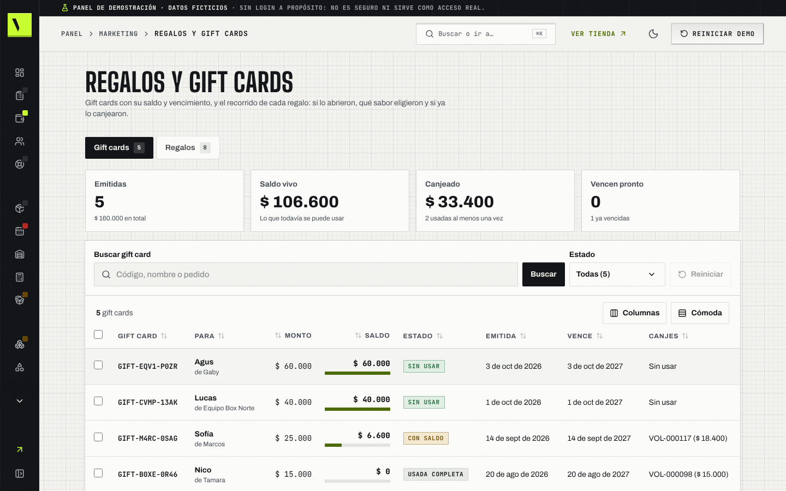

1. Entrá a **Promos → Regalos y gift cards**.
2. En la pestaña **Gift cards** ves arriba las **emitidas**, el **saldo vivo** (lo que todavía se puede usar), lo
   **canjeado** y las que **vencen pronto** (30 días). La lista muestra código, para quién, monto, **saldo** con su barra,
   estado (**Sin usar**, **Con saldo**, **Usada completa**, **Vencida**), cuándo se emitió, **cuándo vence** y en qué
   pedidos se usó. Filtrá por estado o buscá por código, nombre o pedido.
3. En la pestaña **Regalos** ves cada regalo con su estado (**Enviado**, **Abierto**, **Sabor elegido**, **Canjeado**)
   y la columna **Sabor o tamaño elegido**: es lo que tenés que armar. "Falta elegir" quiere decir que lo abrió pero
   todavía no eligió.

**Cómo se usa una gift card.** El cliente escribe el código (GIFT-XXXX-XXXX) en el paso **Pago** del checkout: el saldo
se descuenta del total como un renglón "Saldo de gift card" (es un descuento, no un pago). Si no alcanza, el resto lo
paga con el medio que elija; si sobra, le queda el saldo para la próxima. Una vencida o sin saldo no se acepta.

> En la demo: las gift cards y los regalos de muestra son inventados; las que se compran en este navegador aparecen acá.

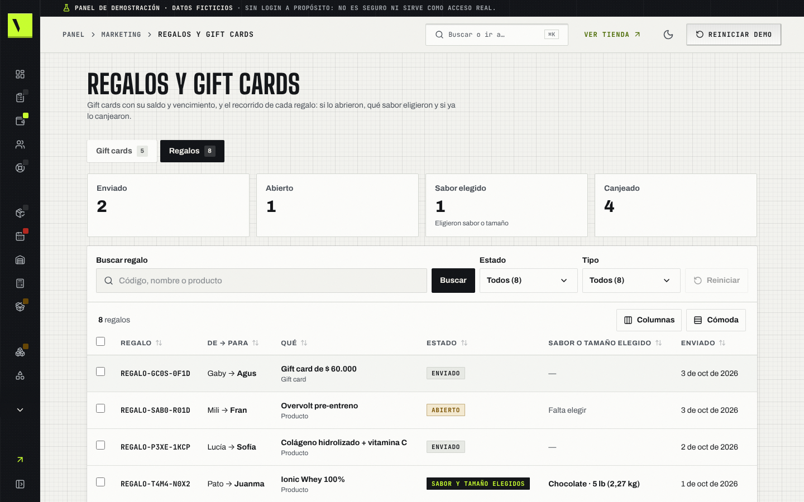

---

## 12. Campañas

Doce fechas comerciales (Día de la Madre, Halloween, CyberMonday, Black Friday, Navidad, Año Nuevo, San Valentín,
Vuelta al gym, Hot Sale, Día del Padre, Día del Amigo y Operación verano) y cinco días del deporte (CrossFit Open, Día
de la Actividad Física, del Futbolista, del Running y del Boxeador). Cada una cambia los colores de la tienda y suma su
key visual, cinta, cupón, productos y pantalla de carga. Antes se llamaba **Temáticas** (el enlace viejo y el del viejo resumen de Marketing te traen acá).

Los días del deporte vienen con sus **fechas reales de 2027**: CrossFit Open del 18 de febrero al 8 de marzo (tres
semanas, un WOD por semana), Actividad Física el 6 de abril (Día Mundial, OMS), Running el primer miércoles de junio
(2 de junio, Global Running Day), Futbolista el 22 de junio (la AFA lo pasó del 14 de mayo en 2021, por el gol de
Maradona en 1986) y Boxeador el 14 de septiembre (Firpo–Dempsey, 1923). Cada campaña arranca unos días antes y termina
el día mismo. Vuelta al gym quedó del 9 al 21 de marzo para no pisarse con el Open. El Open y el Running cambian de
día cada año: revisalos en el editor cuando se confirme el calendario.

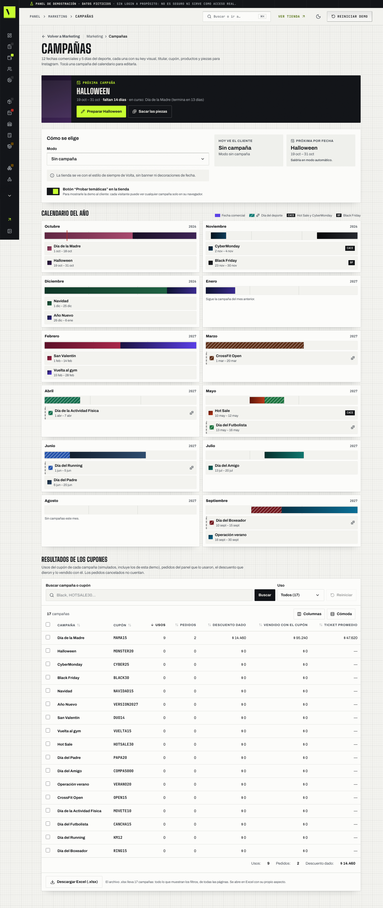

1. Entrá a **Campañas**. Arriba está la **Próxima campaña** con los días que faltan (también la ves en **Hoy en tu tienda**, con su checklist).
2. En **Modo** elegí **Automática según la fecha**, **Siempre la que elija** (y la **Campaña fija**) o **Sin campaña**.
3. El **Calendario del año** muestra cada campaña como una barra. Los días del deporte van rayados y con una mancuerna;
   Hot Sale y CyberMonday llevan el sello **CACE** y Black Friday el sello **BF**. Tocá una para editarla.
4. En el editor cambiás **Titular**, **Bajada**, **Texto de la cinta superior**, **Desde** y **Hasta**, el **Cupón de la
   campaña** (o **Crear cupón** ahí mismo) y los **Productos en oferta**, mirando la **Vista previa en vivo** en celular y
   computadora. Tocá **Guardar campaña**. Con **Campaña habilitada** apagado, esa fecha no sale.
5. Dos campañas no pueden compartir un día: si las fechas se pisan, el editor te dice con cuál y no guarda.
6. **Descuento real**: si subiste el precio antes de la campaña y con el cupón no queda por debajo del precio más bajo de
   los últimos 30 días, el editor (y **Cupones**) te avisa en qué productos. Bajá el precio, subí el descuento o sacalos.
7. Abajo, **Resultados de los cupones**: usos, pedidos, descuento dado y lo vendido con el cupón de cada campaña.
8. **Sacar las piezas** arma el post 1:1, la historia 9:16 con la cuenta regresiva y la gift card de la fecha con el key
   visual de la campaña. **Descargar las 3** las baja en PNG (también desde el **Estudio de contenido**).

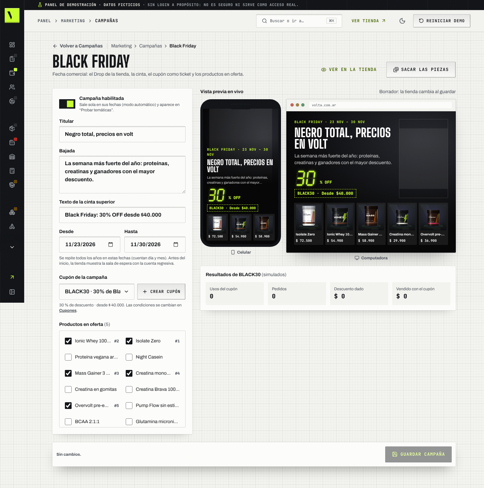

El botón **Probar temáticas** de la tienda (lo prendés o apagás acá) sirve para mostrar cualquier fecha sin cambiarle
nada al resto: cada uno la ve solo en su equipo.

---

## 13. Estudio de contenido (Instagram)

Placas para Instagram con tus potes animados, sin diseñador.

1. Entrá a **Campañas → Estudio de contenido**.
2. Elegí la **Plantilla**: **Oferta de la fecha**, **Producto destacado**, **Stack del mes** o **Cupón del juego**.
3. Elegí la **Temática** (la fecha) y, si hace falta, los productos.
4. Ajustá el **Titular**, la **Bajada** y los textos. Podés **Usar una foto propia**.
5. Elegí el formato: **Post 1:1**, **Historia o reel 9:16** o **Carrusel 4:5**.
6. Tocá **Descargar imagen (PNG)** o **Grabar video** (con música). El carrusel baja una imagen por diapositiva.
7. Abajo está el **Texto para el posteo**: **Copiar texto** y pegalo en Instagram. **Otra idea** te propone otro gancho.
8. **Piezas de la campaña** (arriba) arma el post, la historia con cuenta regresiva y la gift card de la fecha con su
   key visual (ver [Campañas](#12-campañas)).

---

## 14. Contenido de la tienda

En **Ajustes → Contenido** cambiás lo que se lee en el inicio y en la ayuda, sin pedirle nada a nadie:

- **Carrusel del inicio**: las diapositivas grandes con producto, imagen, titular, bajada y datos de compra.
- **Textos de inicio**: el bloque del stack en vivo. **Guardar textos**.
- **Preguntas frecuentes**: las de la "Ayuda del box". Cada una lleva su **Tema de la ayuda** (compras, envíos y cadete, pagos, cambios y devoluciones, suplementos y lotes, equipamiento y talles, club y regalos), que decide en qué grupo aparece. **Guardar preguntas**.

### Cambiar el carrusel del inicio

1. Entrá a **Ajustes → Contenido → Carrusel**. Arriba ves la misma diapositiva que aparece en la tienda.
2. Elegí una diapositiva de la lista y su **Producto**. Escribí el **Titular** (hasta 40 caracteres) y la **Bajada**
   (hasta 120); el contador te muestra cuánto queda.
3. Para poner una foto, elegí **Subir imagen propia**. Acepta JPG, PNG o WebP de hasta **10 MB**, con al menos **400 px
   en el lado más chico**. El panel la reduce a un máximo de 900 px en el lado más largo para que cargue liviana.
4. Escribí el **Texto alternativo** (hasta 120 caracteres): una descripción breve de lo que muestra la foto, para
   quien usa lector de pantalla. Ajustá la posición horizontal y vertical (0–100 %) y el zoom (1–2) mirando la vista
   previa. **Quitar imagen** vuelve a mostrar el envase dibujado del producto.
   Si una campaña muestra ese producto, también usa su imagen y encuadre, con el texto y cupón de la campaña.
5. Podés **Agregar** hasta 4 diapositivas, ordenarlas con **Subir**/**Bajar**, quitarlas o apagar **Visible** para
   ocultarlas sin borrarlas. El primer destacado visible sale primero; si hay una campaña vigente, va antes.
6. Tocá **Guardar carrusel** para publicar en la tienda de este navegador. Si te vas sin guardar, al volver podés
   recuperar el borrador o descartarlo.

Las fotos se procesan y guardan **solo en tu navegador**, sin subirse a ningún servicio. Si no queda espacio para
guardar, el panel te avisa: quitá alguna imagen o usá una más liviana y volvé a guardar. **Reiniciar demo** borra los
cambios y las fotos de ese navegador.

En la tienda el carrusel avanza cada 4–5 segundos. Se frena con el mouse encima, al enfocar sus controles o tocarlo;
tiene flechas, indicadores y un botón de pausa, y en el celular se puede deslizar con el dedo. Con **reducir movimiento**
activado no avanza solo. Debajo quedan **Comprá por categoría**, **Entrená por objetivo** y las ofertas de campaña.

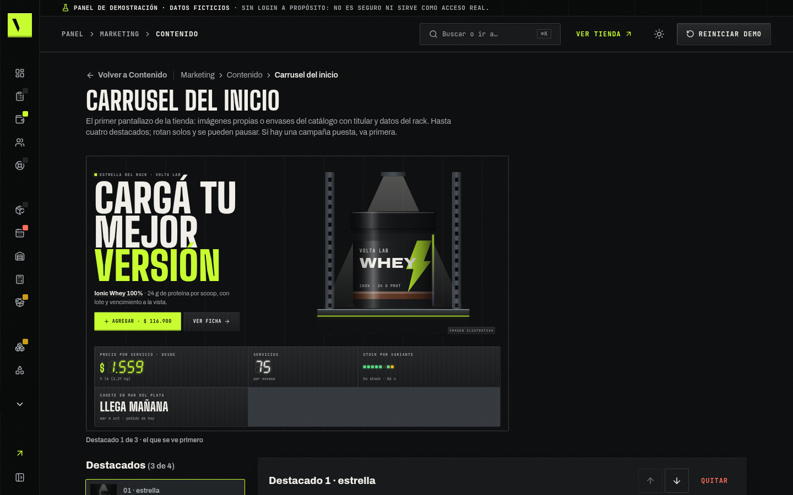

---

## 15. Ajustes

Cada parte es una pestaña; el **Contenido** (sección 14) y los **Emails** (sección 10) también viven acá.

- **Contacto y WhatsApp**: el número del botón de WhatsApp de la tienda, con código de país y área
  (54 9 223 …). **Guardar contacto**.
- **Medios de pago**: cuáles se ofrecen (Mercado Pago, transferencia, QR), el descuento por transferencia o QR y
  cuántas horas se reserva un pedido sin comprobante. **Guardar medios de pago**.
- **Datos de cobro**: alias, CBU/CVU, titular y QR que ve el comprador para transferir. **Guardar datos de cobro**.
- **Envíos y retiro**: envío gratis desde cierto monto y cada forma de entrega (retiro en el local, cadete en Mar del
  Plata con sus códigos postales, envío al resto del país) con precio y plazo. **Guardar envíos**.

> En la demo: usá solo datos de prueba. **No cargues datos bancarios reales** ni un QR de verdad.

---

## 16. Una rutina que funciona

**Cada mañana (10 minutos)**
1. **Hoy en tu tienda**: hacé la lista de arriba hacia abajo. Primero lo atrasado y los comprobantes (aprobá solo lo que
   ya viste en tu cuenta).
2. **Pedidos → Para armar**: juntá los potes de lo que sale y hacé el control de lote. Después, **Despachos**: la hoja de
   ruta para el cadete.
3. **Avisarles** (en Hoy): mandá el aviso a quien se le termina el pote.

**Cada semana**
1. **Compras → Proveedores**: copiá los pedidos y mandalos.
2. **Lotes que vencen** (en Hoy o en **Stock → Productos y stock**): liquidá lo que no vas a vender a tiempo.
3. **Estudio de contenido**: bajá la historia de la oferta de la semana.

**Cuando cambia la lista del proveedor**
1. **Importar Excel** con la lista nueva, o **Aumentar precios** por marca.
2. Revisá **Costos y margen** con el filtro **Margen bajo o pérdida**.

**Antes de cada fecha especial**
1. **Campañas**: revisá el cupón, los productos y el aviso de descuento real de la próxima fecha, y sacá las piezas.
2. **Estudio**: prepará el post y la historia.

---

## 17. Qué es simulado en la demo

| En la demo | En la tienda real |
|---|---|
| El panel se abre sin usuario ni contraseña, con datos inventados | Entrás con tu usuario y contraseña; los datos son los tuyos |
| Todo se guarda solo en el equipo y el navegador que usás; **Reiniciar demo** lo borra | Se guarda en la tienda y lo ven todos los equipos |
| Ningún pago es real: aprobar un comprobante solo cambia el estado | Mercado Pago confirma solo; la transferencia la aprobás vos después de verla en tu cuenta |
| No sale ningún email: quedan en la Bandeja de salida | Le llegan al cliente |
| El WhatsApp se abre con el mensaje escrito, pero lo mandás vos. Los teléfonos de los clientes son inventados | Igual, con el teléfono que dejó el cliente |
| El giro de la ruleta y el cupón del juego valen uno por navegador | Uno por cuenta |
| Las suscripciones a un pack no cobran ni envían nada: solo se cuentan y se listan | El cobro mensual y los avisos de cada entrega se definen con el medio de pago real |
| Proveedores, clientes, pedidos y códigos de lote son inventados | Son los tuyos |
| La fecha del panel está fija en el lunes 5 de octubre de 2026 | Es la fecha de hoy |
| Las gift cards no tienen dinero real: el saldo es un descuento simulado y el regalo viaja dentro del link | El servidor emite la gift card, guarda el saldo y el link es una clave al azar |
