# Manual del dueño

Cómo se usa el panel de tu tienda en el día a día: qué hace cada sección y cómo hacer cada tarea, paso a paso. Está
escrito con la tienda de ejemplo **VOLTA**; en tu tienda vas a ver tu marca, pero los botones son los mismos.

> **Estás en la demo.** Todo lo que hagas queda guardado solo en el equipo y el navegador que estás usando, con datos
> inventados. Nada se cobra, no sale ningún email ni mensaje y nadie más ve tus cambios. **Reiniciar demo** deja todo
> como al principio. Cada sección te avisa qué es simulado.

## Índice

1. [Cómo moverte por el panel](#1-cómo-moverte-por-el-panel)
2. [Inicio: tu día en una pantalla](#2-inicio-tu-día-en-una-pantalla)
3. [Pedidos, pagos y reclamos](#3-pedidos-pagos-y-reclamos)
4. [Clientes y recompra](#4-clientes-y-recompra)
5. [Productos, stock y lotes](#5-productos-stock-y-lotes)
6. [Importar la lista del proveedor (o tu catálogo)](#6-importar-la-lista-del-proveedor-o-tu-catálogo)
7. [Aumentar precios](#7-aumentar-precios)
8. [Preparación y despachos](#8-preparación-y-despachos)
9. [Proveedores, compras, costos e insumos](#9-proveedores-compras-costos-e-insumos)
10. [Emails automáticos](#10-emails-automáticos)
11. [Cupones, ruleta, juego, misiones y descuento stack](#11-cupones-ruleta-juego-misiones-y-descuento-stack)
12. [Temáticas](#12-temáticas)
13. [Estudio de contenido (Instagram)](#13-estudio-de-contenido-instagram)
14. [Contenido de la tienda](#14-contenido-de-la-tienda)
15. [Ajustes](#15-ajustes)
16. [Una rutina que funciona](#16-una-rutina-que-funciona)
17. [Qué es simulado en la demo](#17-qué-es-simulado-en-la-demo)

### Palabras que vas a ver

| Palabra | Qué quiere decir |
|---|---|
| Variante | Cada combinación de sabor y tamaño de un producto (Ionic Whey Chocolate 2 lb es una variante) |
| Servicio | Una toma (un scoop, una cápsula). El precio por servicio es lo que le sale cada toma a tu cliente |
| Lote | El código y el mes de vencimiento que trae cada tanda de potes |
| Stack | Varios suplementos que se toman juntos (proteína + creatina + pre). Con varias categorías hay descuento |
| Recompra | Cuando a un cliente se le está por terminar el pote y le conviene volver a comprar |
| Segmento | Un grupo de clientes que el panel arma solo (nuevos, VIP, a los que se les termina esta semana…) |

---

## 1. Cómo moverte por el panel

El panel de la demo está en la dirección de tu tienda + `/admin-demo/`. En la tienda real entrás con tu usuario y
contraseña.

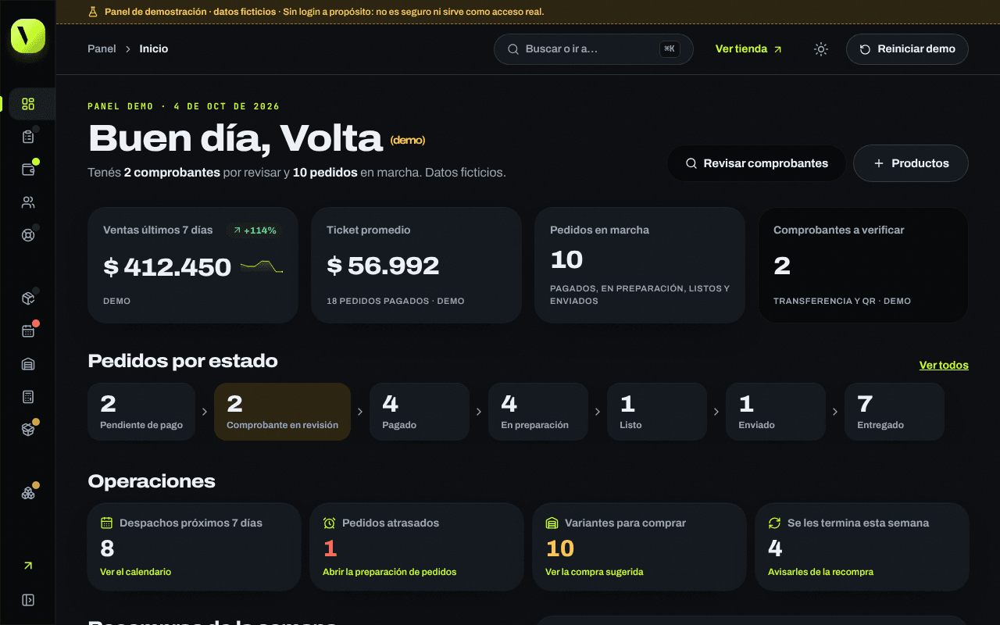

**En la compu**
- A la izquierda está el menú, agrupado en **Ventas**, **Operaciones**, **Catálogo**, **Marketing** y **Ajustes**.
  Se abre al pasar el mouse por encima. Los puntitos de color avisan que hay algo pendiente (comprobantes, pedidos
  atrasados, stock bajo).
- Arriba: **Buscar o ir a…** (también con Ctrl+K) para abrir un pedido, un cliente o una sección escribiendo; **Ver
  tienda**; el sol/luna para el modo claro u oscuro; y **Reiniciar demo**.

**En el celular**

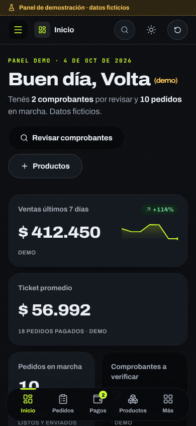

- Abajo tenés las pestañas **Inicio**, **Pedidos**, **Pagos**, **Productos** y **Más** (el resto de las secciones).
- Arriba, el menú (☰), el buscador, el modo claro/oscuro y Reiniciar demo (la flecha circular).

**Tablas**: casi todas las listas (pedidos, clientes, productos, costos…) tienen buscador, filtros, **Reiniciar**
filtros, **Columnas** para elegir qué ver, **Ver en formato Excel** y **Descargar Excel (.xlsx)** con lo que estás
filtrando.

---

## 2. Inicio: tu día en una pantalla

Lo primero que ves a la mañana: "Buen día", cuántos comprobantes tenés para revisar y cuántos pedidos en marcha.

- **Tarjetas de arriba**: ventas de los últimos 7 días, ticket promedio, pedidos en marcha y comprobantes a verificar.
- **Pedidos por estado**: tocá un estado para ver esos pedidos.
- **Operaciones**: despachos de los próximos 7 días, pedidos atrasados, variantes para comprar y clientes a los que se
  les termina el pote esta semana. Cada tarjeta lleva a su sección.
- **Recompras de la semana** y **Próximos a vencer**: a quién escribirle y qué liquidar (ver secciones 4 y 5).
- Más abajo: ventas por día (tocá una barra para ver los pedidos de ese día), lo más pedido, últimos pedidos, el Club,
  actividad reciente y reclamos.

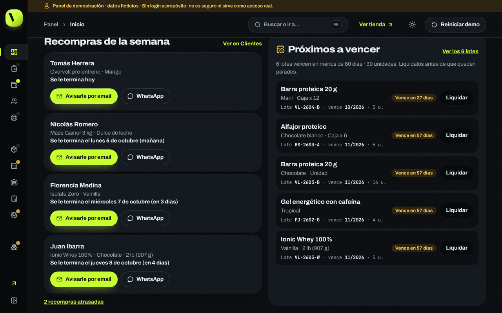

---

## 3. Pedidos, pagos y reclamos

### Los estados de un pedido

Pendiente de pago → Comprobante en revisión → Pagado → En preparación → Listo → Enviado → Entregado. Además, un
pedido puede quedar **En reclamo** o **Cancelado**. Cada cambio queda en el historial del pedido y, si corresponde,
le manda al cliente su email (sección 10).

### Revisar un pedido

1. Entrá a **Pedidos**. Filtrá por **Etapa** (Por cobrar, Por preparar, En preparación, Listos…) o buscá por código o
   cliente.
2. Tocá la fila del pedido (por ejemplo **VOL-000123**).
3. Arriba ves el estado del pago, el de la preparación, el total y la **Próxima acción** (qué tenés que hacer vos).
4. Más abajo: el cliente, los productos con el **lote que sale** de cada uno, el pago, la entrega, el historial, las
   notas internas y los emails que ya le llegaron.

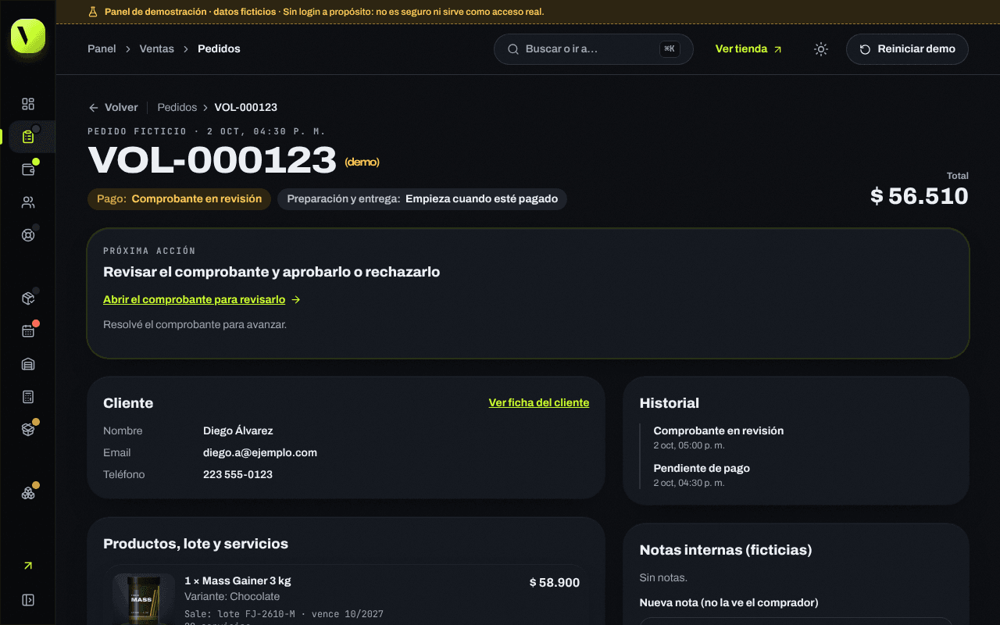

**Cambiar el estado**: en la ficha, tocá el botón del estado siguiente (por ejemplo **En preparación**) y confirmá.
Para pasar a **Listo** te pide el control de lote (sección 8). Para cambiar varios pedidos juntos: en la lista, tildá
los pedidos y usá la acción en lote que aparece (por ejemplo **Pasar a En preparación**).

**Fecha de despacho**: en la ficha, **Fecha comprometida de despacho** → elegí el día → **Guardar**. **Ver la
capacidad en el calendario** te muestra si el cadete tiene lugar ese día.

**Notas internas**: escribí en **Nueva nota (no la ve el comprador)** y tocá **Agregar nota**. Sirve para "pidió
cambiar a chocolate" o "retira el jueves".

### Aprobar o rechazar un pago por transferencia o QR

Cuando el cliente paga por transferencia o QR, sube el comprobante y el pedido queda **Comprobante en revisión**.
Subir un comprobante **nunca** marca el pedido como pagado: lo aprobás vos.

1. Entrá a **Pagos manuales** (o tocá **Revisar comprobantes** en el inicio).
2. En **Por revisar**, mirá el comprobante, el monto esperado y el medio.
3. Fijate en tu banco o billetera que la plata haya entrado.
4. Si entró: **Aprobar** y confirmá. El pedido pasa a Pagado y al cliente le llega "Pago aprobado".
5. Si no coincide: **Rechazar**, escribí el motivo (por ejemplo "El monto no coincide") y confirmá. El cliente recibe
   el motivo y cómo mandar otro.
6. En **Resueltos** queda todo lo que ya revisaste, con su motivo.

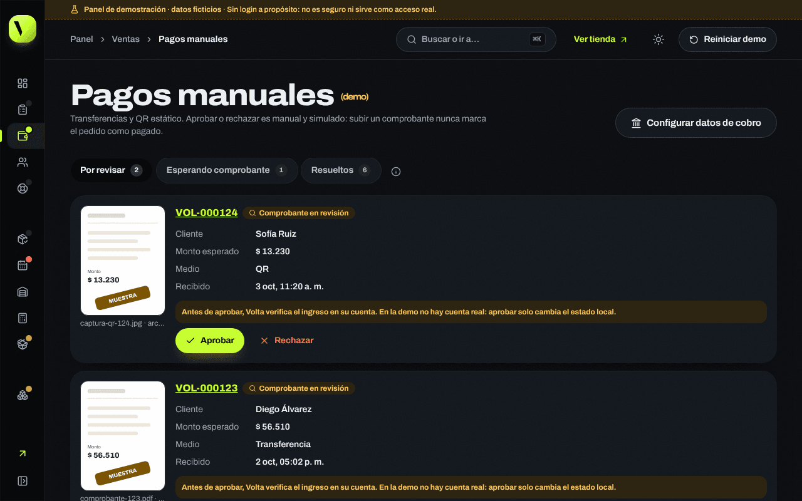

> En la demo: no hay cuenta bancaria real. Aprobar solo cambia el estado en tu navegador. Los pagos con Mercado Pago
> no llevan comprobante; en la tienda real se confirman solos.

### Reclamos, devoluciones y arrepentimientos

1. Entrá a **Reclamos**. En **Pendientes** están los abiertos (arrepentimiento, devolución o reclamo).
2. Tocá uno para ver el mensaje del cliente y su pedido.
3. Usá **Marcar en curso** mientras lo resolvés, y después **Resolver** o **Rechazar**.

Los arrepentimientos que el cliente manda desde el botón de arrepentimiento de la tienda aparecen acá solos.

---

## 4. Clientes y recompra

En **Clientes** está cada persona que te compró, con o sin cuenta, unida por su email.

### Saber a quién escribirle esta semana

1. Entrá a **Clientes**.
2. En **Segmento** elegí **Se le termina esta semana**.
3. Vas a ver a quién se le termina el pote y cuál (columna **Se le termina**). Tocá el nombre para abrir su ficha.

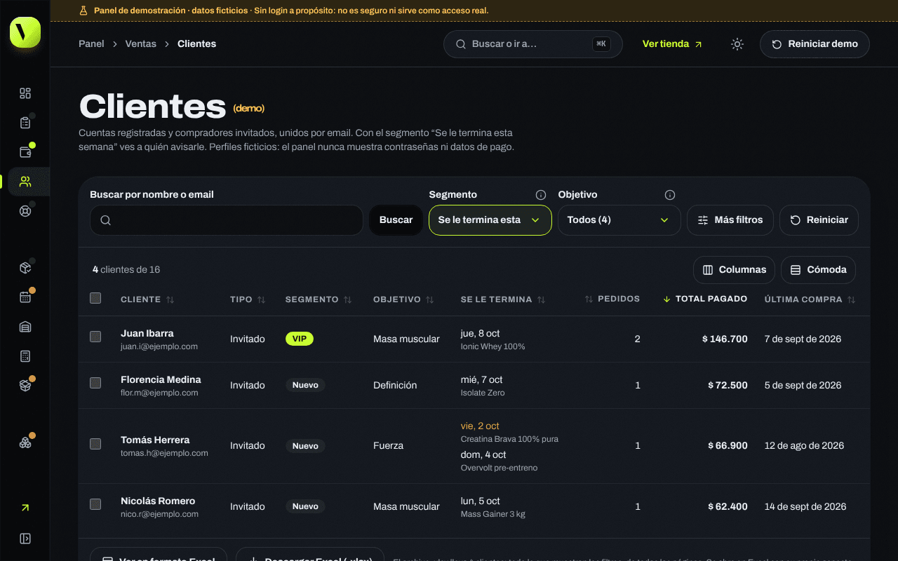

Otros segmentos útiles: **Recompra atrasada** (ya se le terminó y no volvió), **Nuevos**, **Frecuentes**, **VIP** y
**Sin compras**. También podés filtrar por **Objetivo** (masa muscular, fuerza, definición…).

### Avisarle que se le está por terminar

1. Abrí la ficha del cliente (por ejemplo **Juan Ibarra**).
2. En **Se le termina** ves cada pote con su batería y la fecha: "Se le termina el jueves 8 de octubre (en 4 días)".
   El cálculo sale de los servicios del pote y de cuándo lo recibió (un servicio por día; pre-entrenos y aminoácidos,
   4 por semana). Es orientativo.
3. Tocá **Avisarle por email** o **WhatsApp** (abre WhatsApp con el mensaje ya escrito).
4. Queda marcado "Avisado por email" y no se repite para ese pote. Lo que se termina más adelante dice "Avisale desde
   el…".

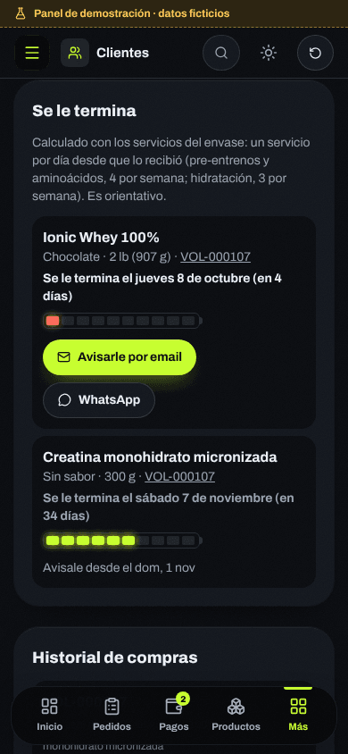

Lo mismo podés hacer desde **Recompras de la semana**, en el inicio.

**En la ficha también**: el historial de compras, el **Objetivo** (si no lo cargás, se deduce de lo que compra), el
cumpleaños y notas internas (**Nota nueva** → **Guardar nota**).

> En la demo: el email queda en la **Bandeja de salida** (sección 10) y el WhatsApp no se manda solo: se abre para que
> lo envíes vos.

---

## 5. Productos, stock y lotes

En **Productos y stock** tenés el catálogo entero. Arriba, dos avisos: **lotes que vencen en menos de 60 días** y
**variantes que necesitan reposición**. Con **Productos** ves un renglón por producto; con **Variantes**, uno por
sabor y tamaño, con su stock.

### Cargar o editar un producto

1. Tocá **Nuevo producto**, o **Editar** en el renglón de un producto.
2. Completá los pasos: foto (o el envase dibujado), nombre y descripción, categoría y precio, **variantes** (sabor,
   tamaño, precio, servicios y costo del proveedor), medidas de envío, marca, objetivos y sellos (sin TACC, vegano…).
3. En cada variante cargá sus **lotes**: código, mes de vencimiento y unidades. El stock es la suma de los lotes y
   **sale primero el que vence primero** (lo marca como "Sale primero").
4. Tocá **Guardar**. Te avisa si falta algo (por ejemplo, un lote con unidades pero sin código).

**Pausar un producto**: apagá el interruptor **Visible** en su renglón. Deja de verse en la tienda sin borrarlo.

**Ver cómo queda**: **Ver** en el renglón o **Ver en tienda** desde el editor.

### Liquidar un lote que está por vencer

1. En **Productos y stock** tocá **6 lotes vencen en menos de 60 días** (el número cambia) o **Liquidar** en
   **Próximos a vencer** del inicio.
2. Tocá **Liquidar** en el lote (por ejemplo VL-2603-W de Ionic Whey Vainilla, que vence en 57 días).
3. Elegí el descuento (−10 % a −50 %, u otro porcentaje) y mirá cómo se va a ver en la tienda.
4. Tocá **Liquidar a $ …**.

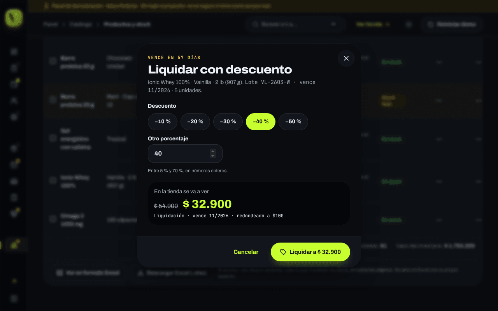

En la tienda ese sabor sale con el precio tachado y "Liquidación · vence 11/2026". Para volver atrás: en el lote,
**Cambiar la liquidación** → **Quitar liquidación**.

### Categorías y objetivos

En **Categorías y objetivos** ordenás las categorías (**Subir**/**Bajar**), elegís las destacadas y editás los
**objetivos** (Masa muscular, Fuerza, Energía…): nombre, color y bajada. Tocá **Guardar objetivos**. La tienda, el
quiz y Armá tu stack usan esos nombres.

---

## 6. Importar la lista del proveedor (o tu catálogo)

Para cuando te llega la lista nueva de la distribuidora, o para cargar tu catálogo de una vez desde Excel.

1. En **Productos y stock** tocá **Importar Excel**.
2. Arrastrá tu archivo (Excel o .csv) o tocá **Elegir archivo**. El archivo no se sube a ningún lado: se lee en tu
   equipo.
3. El panel reconoce si es tu catálogo o una **Lista de un proveedor** y te muestra qué columna es cada cosa (costo,
   precio sugerido, sabor, presentación…). Corregí lo que haga falta.
4. Tocá **Ver vista previa**. Ves cuántas filas **Se actualiza**, cuáles quedan **Sin cambios**, cuáles **No lo
   vendés** y cuáles tienen **error** (con el motivo: "No encontramos la presentación…").
5. Revisá **Con cambios**: costo nuevo, precio viejo → nuevo y margen.
6. Tocá **Actualizar 14 filas** (el número es el de tu lista). Listo: "Costos y precios al día".

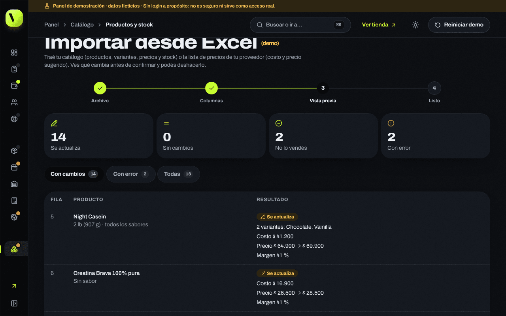

**Si te equivocaste**: **Deshacer importación** y confirmá. Vuelve todo como estaba.

**Para probar sin tu archivo**: **Probar con la lista de un proveedor** (una distribuidora inventada) o **Probar con
una planilla de ejemplo** (como la que muchos locales tienen hoy). Con **Bajar mi catálogo como plantilla** te llevás
un Excel con todos tus productos para editarlo y volver a subirlo.

---

## 7. Aumentar precios

Para subir (o bajar) un porcentaje a una marca, una categoría o todo el catálogo, viendo cada precio antes.

1. En **Productos y stock** tocá **Aumentar precios**.
2. Elegí **Una marca**, **Una categoría** o **Todo el catálogo**, y cuál.
3. Escribí el **Porcentaje** (con signo menos baja: −10) y el **Redondeo** (por ejemplo, a $100).
4. Mirá la lista: precio actual → precio nuevo de cada variante ("9 variantes cambian de precio, en 4 productos").
5. Tocá **Aplicar a 9 variantes** y confirmá con **Sí, aplicar**.

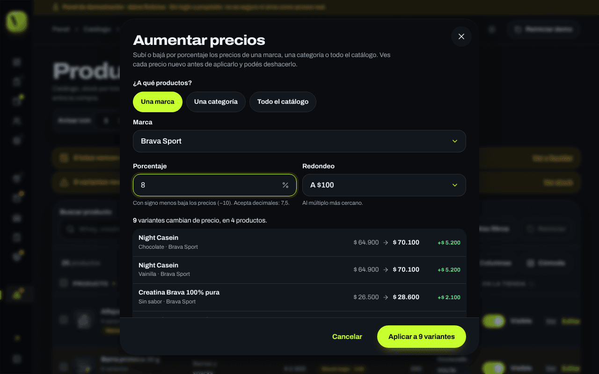

La tienda ya muestra los precios nuevos. **Deshacer aumento** vuelve exacto al precio anterior (el último aumento).

---

## 8. Preparación y despachos

### Preparar pedidos con control de lote

En **Preparación** están los pedidos pagados, en orden de despacho, en cuatro columnas: **Por preparar → Armando →
Control de lote → Listo para despachar**.

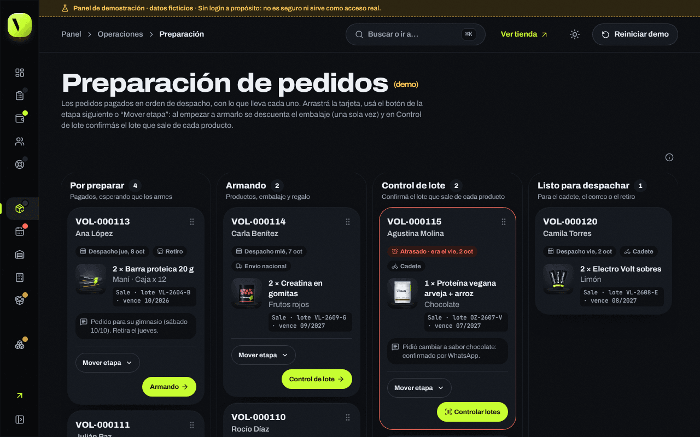

1. En la tarjeta del pedido (por ejemplo **VOL-000113**) tocá el botón de la etapa siguiente: **Armando**. También
   podés arrastrar la tarjeta o usar **Mover etapa**. Al empezar a armarlo se descuenta el embalaje.
2. Cuando lo tenés armado, pasalo a **Control de lote**.
3. Tocá **Controlar lotes**. Sacá el pote que vence primero y fijate que el lote coincida con la etiqueta.
4. Tildá cada producto. Abajo dice "1 de 1 controlados".
5. Tocá **Listo para despachar**. Sin todos los lotes tildados no te deja.

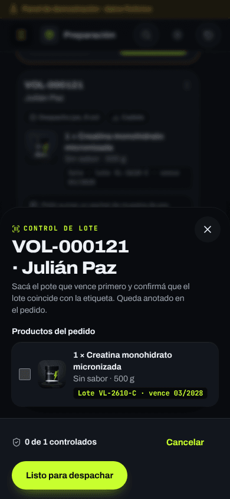

El lote queda anotado en el pedido ("Lote controlado: VL-2604-B · vence 10/2026") y al cliente le llega solo el email
de "listo para retirar" o "listo para salir", según cómo lo recibe.

En el celular, las columnas se eligen con los botones de **Etapa** de arriba.

### Calendario de despachos

En **Calendario de despachos** ves cada pedido en el día que sale: con el cadete en Mar del Plata, por correo o para
retirar.

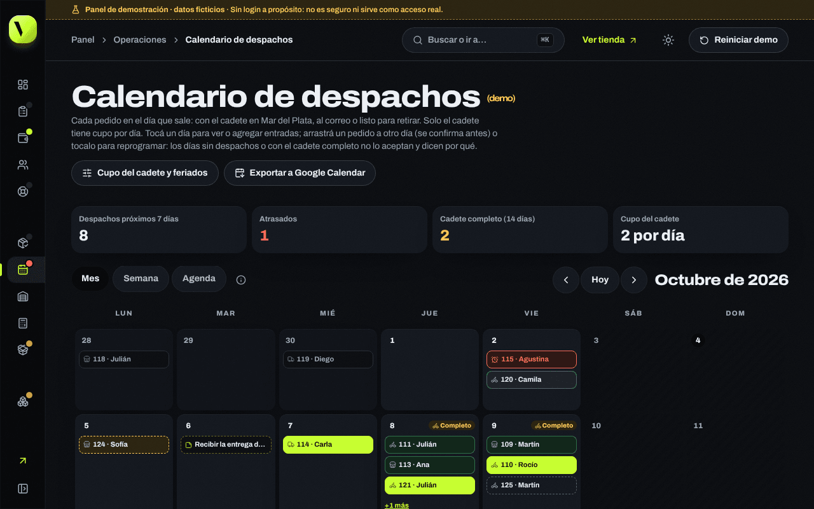

- **Mes**, **Semana** o **Agenda** para cambiar la vista. Los días con el cadete lleno dicen **Completo**.
- **Reprogramar**: arrastrá el pedido a otro día (te pide confirmar) o tocalo y elegí, por ejemplo, **Día hábil
  siguiente**. La fecha nueva queda en el pedido.
- **Cupo del cadete y feriados**: cuántos envíos hace el cadete por día (2 en la demo), feriados y días sin despacho.
- Tocá un día para ver lo que sale o agregar una tarea o recordatorio ("Recibir la entrega de Krono Nutrition").

---

## 9. Proveedores, compras, costos e insumos

### Qué comprar y a quién

En **Proveedores y compras**, la pestaña **Compra sugerida** junta lo que hay que reponer, agrupado por distribuidora,
con el total al costo, la próxima entrega y si llegás al pedido mínimo.

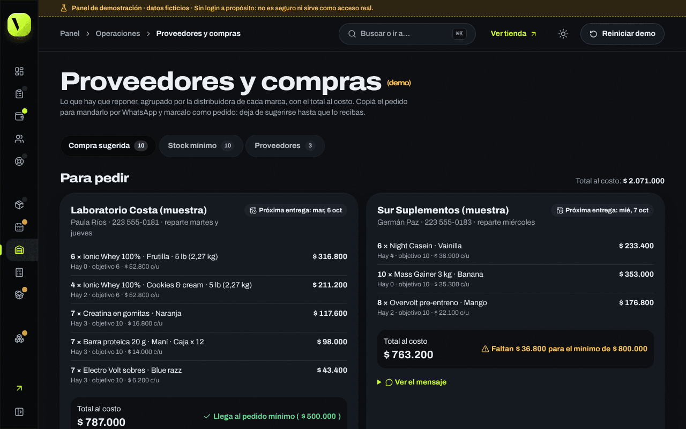

1. Revisá la tarjeta del proveedor (por ejemplo **Sur Suplementos**).
2. Tocá **Copiar pedido para WhatsApp** y pegalo en el chat del proveedor ("Hola Germán, ¿cómo va? Te paso el
   pedido…"). Con **Ver el mensaje** lo leés antes.
3. Tocá **Marcar como pedido**. Deja de sugerirse y pasa a **Pedidos hechos**.
4. Cuando llega la mercadería: **Recibir mercadería** → **Sumar al stock**.

**Stock mínimo**: en esa pestaña ponés, para cada variante, cuántas unidades querés tener como mínimo. Si baja de ahí,
aparece en la compra sugerida. **Proveedores**: los datos de cada distribuidora (contacto, días de reparto, pedido
mínimo).

> En la demo: los proveedores son inventados y el pedido no se manda solo; lo copiás vos.

### Costos y margen

En **Costos y margen** ves cuánto te cuesta cada producto (lo que le pagás al proveedor más el embalaje), cuánto te
deja al precio actual y el precio sugerido para tu **Margen objetivo (%)**. El filtro **Margen bajo o pérdida** te
muestra lo que conviene revisar. Tocá un producto para ver el margen de cada presentación.

### Insumos de embalaje

En **Insumos de embalaje**: cajas, bolsas, precintos, folletos, cinta y los regalos que sumás a los pedidos (sachets,
shakers). Te dice cuánto hay, cuánto piden los pedidos pagados y qué **Reponer**. Para agregar uno: **Nuevo insumo**.

---

## 10. Emails automáticos

Un email en cada momento del pedido (compra recibida, comprobante recibido, pago aprobado, pago no validado,
preparando, listo para retirar, listo para salir, en camino, entregado con "así se toma") y el aviso de **Tu pote se
está por terminar**. Salen solos cuando cambiás el estado del pedido.

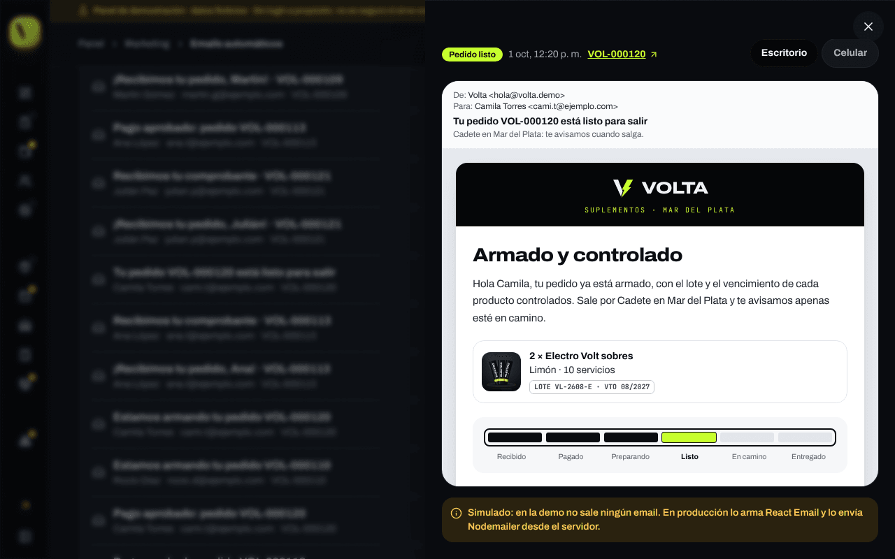

**Pausar uno**: en **Emails automáticos**, apagá **Se envía solo** en su tarjeta.

**Cambiar el texto**:
1. Tocá **Editar** en la tarjeta (por ejemplo **Pago aprobado**).
2. Cambiá el asunto y los textos. Para poner un dato del pedido (nombre del cliente, total, fecha de entrega) tocá el
   texto y después **Insertar …**: en cada email se reemplaza por el dato real.
3. Elegí un pedido en **Con el pedido** para ver la vista previa con datos reales, en **Escritorio** o **Celular**.
4. **Enviar prueba** y después **Guardar cambios**. **Restaurar** vuelve al texto original.

**Bandeja de salida**: todos los emails que "salieron", con buscador y filtro por **Momento**.

> En la demo: no sale ningún email. Todo queda en la Bandeja de salida para que lo veas.

---

## 11. Cupones, ruleta, juego, misiones y descuento stack

Todo está en **Marketing** (el resumen tiene una tarjeta por herramienta).

**Cupones** (Cupones y ruleta → **Cupones**)
1. Tocá **Nuevo cupón**.
2. Escribí el **Código** (de 3 a 20 letras o números, por ejemplo FERIA15) y el **Valor**. Si querés: **Compra
   mínima**, **Usos totales** y **Solo con cuenta**.
3. Tocá **Crear cupón**. Ya funciona en el carrito. Lo pausás con el interruptor **Activo**.

**Ruleta** (Cupones y ruleta → **Configuración de ruleta**): si se ve en la tienda, cuántos días dura el premio y los
gajos. Cada gajo tiene un **Premio** y un **Peso**: cuanto más peso, más sale (ves el porcentaje al lado). Tocá
**Guardar ruleta**. Los premios se eligen de **Premios disponibles**.

**Premios del juego Shaker Rush** (Cupones y ruleta → **Premios del juego**)

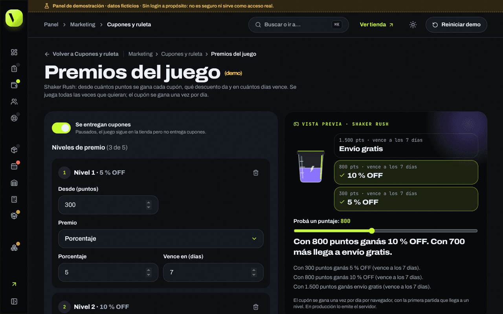

1. Cada nivel tiene **Desde (puntos)**, el **Premio** (porcentaje, monto fijo o envío gratis) y **Vence en (días)**.
2. Con **Probá un puntaje** ves qué gana alguien con, por ejemplo, 800 puntos.
3. **Agregar nivel** (hasta 5) o quitar uno con el tachito.
4. Tocá **Guardar premios**. **Se entregan cupones** apagado pausa los premios (el juego sigue).

El cupón del juego se gana **una vez por día**; se juega todas las veces que quieran.

**Misiones** (**Misiones y premios**): retos para el Club ("Comprá 2 productos" → shaker de regalo). **Nueva misión**,
título, premio y **Guardar misión**. Recomendado: hasta 3 activas.

**Descuento stack**: el porcentaje (0 a 30 %) y cuántas categorías distintas hacen falta (2 a 5). Con la vista previa
ves cuánto ahorra un stack de ejemplo. Tocá **Guardar descuento stack**.

> En la demo: los usos de cupones son simulados y el giro de la ruleta y el cupón del juego valen uno por navegador.

---

## 12. Temáticas

Doce fechas comerciales con estética de gimnasio (Día de la Madre, Halloween, CyberMonday, Black Friday, Navidad, Año
Nuevo, San Valentín, Vuelta al gym, Hot Sale, Día del Padre, Día del Amigo y Operación verano). Cada una cambia los
colores de la tienda y suma su banner, cupón, ofertas y pantalla de carga.

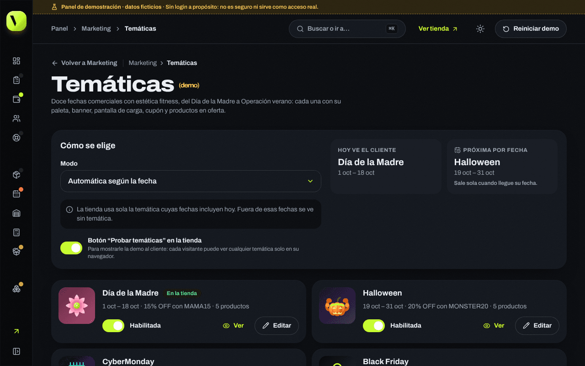

1. Entrá a **Temáticas**.
2. En **Modo** elegí **Automática según la fecha** (sale sola cuando llega cada fecha), **Siempre la que elija** (y
   elegí cuál) o **Sin temática**.
3. Arriba ves **Hoy ve el cliente** y la **Próxima por fecha**.
4. Para cambiar una: **Editar** → **Titular**, **Bajada**, **Texto de la cinta superior**, fechas (**Desde** y
   **Hasta**) y **Productos en oferta** → **Guardar temática**. Con **Habilitada** apagado, esa fecha no sale.
5. **Ver** te la muestra en la tienda.

El botón **Probar temáticas** de la tienda (lo prendés o apagás acá) sirve para mostrar cualquier fecha sin cambiarle
nada al resto: cada uno la ve solo en su equipo.

---

## 13. Estudio de contenido (Instagram)

Placas para Instagram con tus potes animados, sin diseñador.

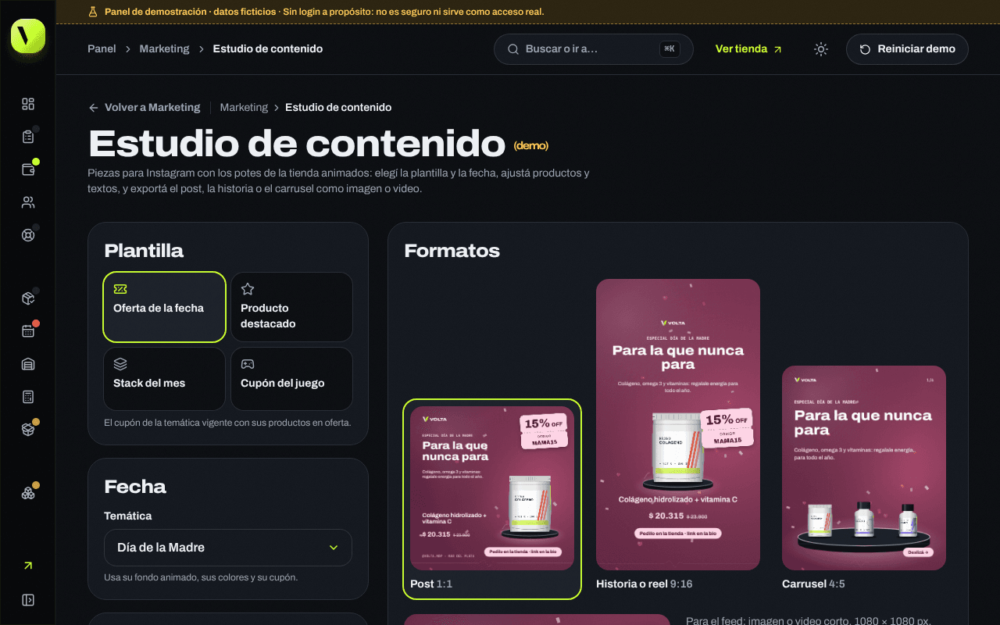

1. Entrá a **Estudio de contenido**.
2. Elegí la **Plantilla**: **Oferta de la fecha**, **Producto destacado**, **Stack del mes** o **Cupón del juego**.
3. Elegí la **Temática** (la fecha) y, si hace falta, los productos.
4. Ajustá el **Titular**, la **Bajada** y los textos. Podés **Usar una foto propia**.
5. Elegí el formato: **Post 1:1**, **Historia o reel 9:16** o **Carrusel 4:5**.
6. Tocá **Descargar imagen (PNG)** o **Grabar video** (con música). El carrusel baja una imagen por diapositiva.
7. Abajo está el **Texto para el posteo**: **Copiar texto** y pegalo en Instagram. **Otra idea** te propone otro gancho.

---

## 14. Contenido de la tienda

En **Contenido** cambiás lo que se lee en el inicio y en la ayuda, sin pedirle nada a nadie:

- **Carrusel**: las diapositivas grandes del inicio (imagen, título, bajada y botón). Podés crear, reordenar y quitar.
  **Guardar carrusel**.
- **Textos de inicio**: el bloque "Tu estante, según tu objetivo". **Guardar textos**.
- **Preguntas frecuentes**: las de la página de ayuda. **Guardar preguntas**.

---

## 15. Ajustes

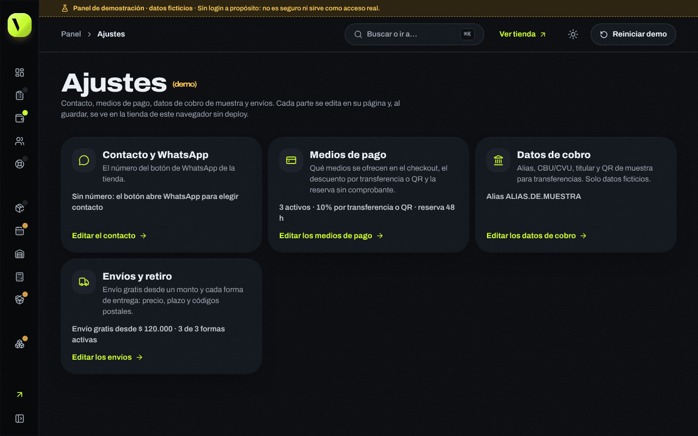

- **Contacto y WhatsApp**: el número del botón de WhatsApp de la tienda, con código de país y área
  (54 9 223 …). **Guardar contacto**.
- **Medios de pago**: cuáles se ofrecen (Mercado Pago, transferencia, QR), el descuento por transferencia o QR y
  cuántas horas se reserva un pedido sin comprobante. **Guardar medios de pago**.
- **Datos de cobro**: alias, CBU/CVU, titular y QR que ve el comprador para transferir. **Guardar datos de cobro**.
- **Envíos y retiro**: envío gratis desde cierto monto y cada forma de entrega (retiro en el local, cadete en Mar del
  Plata con sus códigos postales, envío al resto del país) con precio y plazo. **Guardar envíos**.

> En la demo: usá solo datos de prueba. **No cargues datos bancarios reales** ni un QR de verdad.

---

## 16. Una rutina que funciona

**Cada mañana (10 minutos)**
1. **Inicio**: comprobantes por revisar → **Pagos manuales** → aprobá lo que ya entró.
2. **Preparación**: armá lo de hoy y hacé el control de lote.
3. **Recompras de la semana**: avisale a quien se le termina el pote.

**Cada semana**
1. **Proveedores y compras**: copiá los pedidos y mandalos.
2. **Próximos a vencer**: liquidá lo que no vas a vender a tiempo.
3. **Estudio de contenido**: bajá la historia de la oferta de la semana.

**Cuando cambia la lista del proveedor**
1. **Importar Excel** con la lista nueva, o **Aumentar precios** por marca.
2. Revisá **Costos y margen** con el filtro **Margen bajo o pérdida**.

**Antes de cada fecha especial**
1. **Temáticas**: revisá el cupón y los productos en oferta de la fecha.
2. **Estudio**: prepará el post y la historia.

---

## 17. Qué es simulado en la demo

| En la demo | En la tienda real |
|---|---|
| El panel se abre sin usuario ni contraseña, con datos inventados | Entrás con tu usuario y contraseña; los datos son los tuyos |
| Todo se guarda solo en el equipo y el navegador que usás; **Reiniciar demo** lo borra | Se guarda en la tienda y lo ven todos los equipos |
| Ningún pago es real: aprobar un comprobante solo cambia el estado | Mercado Pago confirma solo; la transferencia la aprobás vos después de verla en tu cuenta |
| No sale ningún email: quedan en la Bandeja de salida | Le llegan al cliente |
| El WhatsApp se abre con el mensaje escrito, pero lo mandás vos | Igual |
| El giro de la ruleta y el cupón del juego valen uno por navegador | Uno por cuenta |
| Proveedores, clientes, pedidos y códigos de lote son inventados | Son los tuyos |
| La fecha del panel está fija en el 4 de octubre de 2026 | Es la fecha de hoy |
